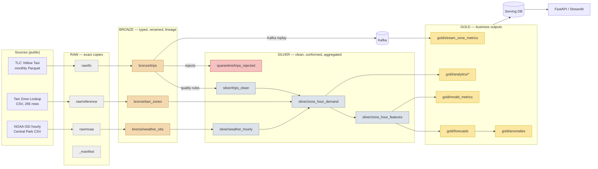
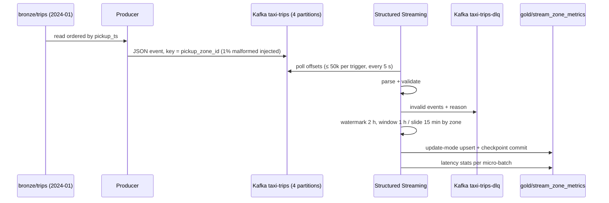

# NYC MobilityPulse — Source Data, Pipeline Steps and Layer Outputs

**Team:** The Petabyte Pack · **Companion to:** [Plan.md](Plan.md)
**Purpose:** Explain, in detail, (1) what source data we use, (2) what every pipeline step does and why, and (3) exactly what each layer (raw → bronze → silver → gold → serving) contains.

> Row counts and file sizes marked "~" are approximate public figures for 2024 and will be replaced by the real numbers written to `raw/_manifest.parquet` and the data-quality reports after ingestion.

---

## Contents
1. [Big picture](#1-big-picture)
2. [Source data](#2-source-data)
3. [Layer summary](#3-layer-summary)
4. [Step-by-step pipeline](#4-step-by-step-pipeline)
5. [Streaming path](#5-streaming-path)
6. [ML and anomaly path](#6-ml-and-anomaly-path)
7. [Serving layer](#7-serving-layer)
8. [Worked example: one trip through every layer](#8-worked-example-one-trip-through-every-layer)
9. [Physical storage layout](#9-physical-storage-layout)
10. [Course-concept mapping](#10-course-concept-mapping)

---

## 1. Big picture



**One-sentence story:** we take ~41 M taxi trips per year, attach *where* (zone/borough) and *weather*, roll them up into "how many pickups happened in zone X during hour H", and use that table to (a) answer analytics questions, (b) predict next hour's pickups per zone, (c) flag unusual hours, and (d) reproduce the same metrics live from a Kafka stream.

---

## 2. Source data

### 2.1 NYC TLC Yellow Taxi Trip Records (primary fact data)

| Property | Value |
|---|---|
| Publisher | NYC Taxi & Limousine Commission (open data) |
| URL pattern | `https://d37ci6vzurychx.cloudfront.net/trip-data/yellow_tripdata_YYYY-MM.parquet` |
| Format | Parquet, one file per month |
| Grain | **One row = one completed taxi trip** (meter on → meter off) |
| Volume | ~3.0 M rows / ~50 MB per month (Jan 2024 ≈ 2.96 M); ~41 M rows / ~0.6 GB per year (2024) |
| Time zone | Timestamps are NYC local wall-clock time, **no time-zone attached** |

**Columns (2024 schema, 19 columns)**

| Source column | Type | Meaning | Used for |
|---|---|---|---|
| `VendorID` | int | Technology provider (1 = Creative Mobile, 2 = Curb/VeriFone) | lineage / dedup key |
| `tpep_pickup_datetime` | timestamp | Meter engaged | **demand time bucket** |
| `tpep_dropoff_datetime` | timestamp | Meter disengaged | duration, dropoff counts |
| `passenger_count` | long/double | Driver-entered passengers (often null) | analytics only |
| `trip_distance` | double | Miles on taximeter | quality, speed, analytics |
| `RatecodeID` | long | 1 standard, 2 JFK, 3 Newark, 4 Nassau/Westchester, 5 negotiated, 6 group, 99 unknown | analytics |
| `store_and_fwd_flag` | string | Y = record buffered offline | not used |
| `PULocationID` | int | Pickup taxi zone (1–265) | **demand location** |
| `DOLocationID` | int | Drop-off taxi zone | dropoff counts |
| `payment_type` | long | 0 flex, 1 card, 2 cash, 3 no charge, 4 dispute, 5 unknown, 6 voided | analytics |
| `fare_amount` | double | Time-and-distance fare | quality, analytics |
| `extra`, `mta_tax`, `tip_amount`, `tolls_amount`, `improvement_surcharge`, `congestion_surcharge`, `Airport_fee` | double | Fare components | not used individually |
| `total_amount` | double | Total charged (excl. cash tips) | quality, avg fare |

**Known data problems we must handle** (these drive the quality rules in Step 4):
- Pickup timestamps outside the file's month (e.g. 2002, 2009 records in a 2024 file).
- Drop-off before pickup; zero or multi-day durations.
- Negative `total_amount` (refunds/voids) and extreme fares.
- Zero or absurd `trip_distance` (e.g. > 10,000 miles).
- Zones 264/265 = "Unknown"/"Outside of NYC".
- Null `passenger_count` / `RatecodeID` for a few % of rows (kept, not rejected).
- Exact duplicate rows.
- Column type drift across years (`passenger_count` int vs double, `airport_fee` vs `Airport_fee`).

### 2.2 Taxi Zone Lookup (dimension)

| Property | Value |
|---|---|
| URL | `https://d37ci6vzurychx.cloudfront.net/misc/taxi_zone_lookup.csv` |
| Grain | One row per taxi zone, **265 rows**, ~12 KB |
| Columns | `LocationID` (int), `Borough` (string), `Zone` (string), `service_zone` (string) |
| Boroughs | Manhattan, Brooklyn, Queens, Bronx, Staten Island, EWR, Unknown, N/A |
| service_zone | Yellow Zone, Boro Zone, Airports, EWR, N/A |

Example rows:

| LocationID | Borough | Zone | service_zone |
|---|---|---|---|
| 132 | Queens | JFK Airport | Airports |
| 161 | Manhattan | Midtown Center | Yellow Zone |
| 237 | Manhattan | Upper East Side South | Yellow Zone |
| 264 | Unknown | N/A | N/A |

Tiny → ideal **broadcast join** dimension.

### 2.3 NOAA Integrated Surface Database (ISD) — hourly weather

| Property | Value |
|---|---|
| URL pattern | `https://www.ncei.noaa.gov/data/global-hourly/access/YYYY/72505394728.csv` |
| Station | 725053-94728, **New York Central Park** (one station = city-wide proxy) |
| Grain | One row per **observation** (several per hour: routine `FM-15` at ~:51, special `FM-16` when weather changes) |
| Volume | ~10–13 K rows / ~5 MB per year |
| Time zone | `DATE` is **UTC** → must convert to America/New_York |

Weather values are packed into **encoded comma-separated strings** with scale factors and quality flags:

| Field | Raw example | Decoding | Missing code | Output column |
|---|---|---|---|---|
| `TMP` | `+0056,1` | 56 / 10 = **5.6 °C**, quality 1 | `+9999` | `temp_c` |
| `DEW` | `-0011,1` | −1.1 °C | `+9999` | `dew_point_c` |
| `WND` | `270,1,N,0046,1` | dir 270°, speed 46 / 10 = **4.6 m/s** | `999` / `9999` | `wind_mps` |
| `VIS` | `016093,1,9,9` | **16,093 m** | `999999` | `visibility_m` |
| `AA1` | `01,0005,9,1` | 1-hour period, 5 / 10 = **0.5 mm** precip | `9999` | `precip_mm` |

Accepted quality flags: `0,1,4,5,9` (others → treated as missing).

### 2.4 Derived reference: US holidays
Generated in code (no download) for `is_holiday` calendar feature (New Year, MLK, Presidents, Memorial, Juneteenth, July 4, Labor, Columbus, Veterans, Thanksgiving, Christmas).

---

## 3. Layer summary

| Layer | What it means | Mutability | Format | Who reads it |
|---|---|---|---|---|
| **Raw** | Byte-for-byte copy of what we downloaded + manifest | Append-only, never edited | Original (Parquet / CSV) | Bronze jobs only |
| **Bronze** | Same records, but **typed, renamed to canonical schema, with lineage**. *No rows dropped.* | Overwrite per month (idempotent) | Parquet | Quality job, Kafka producer |
| **Quarantine** | Rows that failed a quality rule, with reason | Overwrite per month | Parquet | DQ report, debugging |
| **Silver** | **Validated, de-duplicated, conformed (timezone, units) and joined** data; zone-hour aggregates and ML features | Overwrite per month | Parquet | Analytics, ML |
| **Gold** | **Business-ready answers**: analytics tables, forecasts, anomalies, metrics, live stream metrics | Overwrite per run / append for stream | Parquet | Serving export, report |
| **Serving** | Small copy of gold for fast UI/API reads | Rebuilt per export | SQLite | FastAPI, Streamlit |

Rule of thumb: **raw = what we got, bronze = what it says, silver = what is true, gold = what it means.**

---

## 4. Step-by-step pipeline

Each step lists: **Goal → Input → Processing → Output → Checks**. CLI stage name in brackets (`scripts/run_pipeline.py --stage <name>`).

### Step 1 — Ingest sources into RAW `[ingest]`

**Goal:** Get reproducible, verifiable local copies of public data without re-downloading.

**Input:** URLs from `config.yaml › sources`, month list (e.g. `2024-01..2024-12`).

**Processing:**
1. For each TLC month, zone file, NOAA year: check if file exists locally with the same size + SHA-256 as the manifest → skip.
2. Otherwise stream-download to a temp file, verify HTTP 200 and non-zero size, atomically rename.
3. Compute SHA-256 and append a manifest row.

**Output — `raw/`:**
```text
raw/tlc/yellow_tripdata_2024-01.parquet       (~48 MB)
raw/reference/taxi_zone_lookup.csv            (~12 KB)
raw/noaa/72505394728_2024.csv                 (~5 MB)
raw/_manifest.parquet
```

`raw/_manifest.parquet`:

| source | url | local_path | period | bytes | sha256 | downloaded_at | status |
|---|---|---|---|---|---|---|---|
| tlc_yellow | …/yellow_tripdata_2024-01.parquet | raw/tlc/… | 2024-01 | 49,961,641 | 2b7c… | 2026-11-08T10:02Z | downloaded |

**Checks:** file count = requested months; re-run produces `status = skipped` (idempotency).

---

### Step 2 — Raw → BRONZE trips `[bronze]`

**Goal:** One stable, typed schema across all months/years so downstream code never sees source quirks. Keep *every* row (rejection happens in Step 4 so we can count it).

**Input:** `raw/tlc/*.parquet`

**Processing:**
1. Read with column pruning (only the 12 needed source columns).
2. Rename + cast to canonical names/types (handles `airport_fee` vs `Airport_fee`, int vs double drift).
3. Add lineage: `source_file`, `source_month`, `ingested_at`.
4. Add deterministic `record_id = sha2(vendor_id|pickup_ts|dropoff_ts|pu|do|distance|total_amount)` → used for de-dup and Kafka event IDs.
5. Add `pickup_date` (partition column).

**Output — `bronze/trips/` (partitioned by `source_month`)**

| Column | Type | From |
|---|---|---|
| `record_id` | string (64 hex) | derived |
| `vendor_id` | int | VendorID |
| `pickup_ts` | timestamp (NY local) | tpep_pickup_datetime |
| `dropoff_ts` | timestamp (NY local) | tpep_dropoff_datetime |
| `pickup_zone_id` | int | PULocationID |
| `dropoff_zone_id` | int | DOLocationID |
| `passenger_count` | double | passenger_count |
| `trip_distance` | double | trip_distance |
| `ratecode_id` | int | RatecodeID |
| `payment_type` | int | payment_type |
| `fare_amount` | double | fare_amount |
| `total_amount` | double | total_amount |
| `source_file` | string | derived |
| `source_month` | string `YYYY-MM` | derived |
| `ingested_at` | timestamp | derived |
| `pickup_date` | date | derived |

**Checks:** `bronze row count == raw row count` (exact).

---

### Step 3 — Raw → BRONZE reference + weather `[bronze]`

**Goal:** Clean-typed dimension and decoded weather observations.

**3a. Zones → `bronze/taxi_zones/`** (single small file)

| zone_id | borough | zone_name | service_zone | is_known_zone |
|---|---|---|---|---|
| 161 | Manhattan | Midtown Center | Yellow Zone | true |
| 264 | Unknown | N/A | N/A | false |

**3b. NOAA → `bronze/weather_obs/`** (one row per observation, decoded)

Processing: parse `DATE` as UTC → convert to `America/New_York`; decode `TMP/DEW/WND/VIS/AA1` per §2.3; null-out bad-quality or `9999` values; keep `report_type`.

| obs_ts_utc | obs_ts_local | report_type | temp_c | dew_point_c | wind_mps | visibility_m | precip_mm | precip_period_h |
|---|---|---|---|---|---|---|---|---|
| 2024-01-09 18:51 | 2024-01-09 13:51 | FM-15 | 7.2 | 5.0 | 8.2 | 4023 | 6.4 | 1 |

**Checks:** % missing per weather field reported; station/year row count > 8,000.

---

### Step 4 — BRONZE → SILVER clean trips + QUARANTINE `[silver]`

**Goal:** Separate trustworthy trips from bad ones, and **prove** nothing was lost (`input = valid + rejected`).

**Input:** `bronze/trips`, `bronze/taxi_zones`

**Processing:**
1. Compute `duration_min = (dropoff_ts − pickup_ts)/60` and `speed_mph = trip_distance / (duration_min/60)`.
2. Evaluate every rule; `reject_reasons` = array of all failures, `reject_reason` = first failure (fixed order below).
3. De-duplicate valid rows on `record_id` (keep first; extras → quarantine as `DUPLICATE`).
4. Broadcast-join zones to add `pickup_borough`, `pickup_zone_name`, `dropoff_borough`.
5. Add time keys: `pickup_hour = date_trunc('hour', pickup_ts)`, `hour_of_day`, `day_of_week`.

**Quality rules** (thresholds from `config.yaml › quality`):

| Order | Code | Rule (row rejected if…) |
|---|---|---|
| 1 | `NULL_TIMESTAMP` | pickup_ts or dropoff_ts null |
| 2 | `OUTSIDE_SOURCE_MONTH` | pickup_ts not in `source_month` |
| 3 | `NEGATIVE_DURATION` | dropoff_ts < pickup_ts |
| 4 | `DURATION_OUT_OF_RANGE` | duration < 1 min or > 360 min |
| 5 | `INVALID_ZONE` | pickup or dropoff zone not in 1–263 |
| 6 | `DISTANCE_OUT_OF_RANGE` | trip_distance ≤ 0 or > 200 |
| 7 | `FARE_OUT_OF_RANGE` | total_amount < 0 or > 1000 |
| 8 | `PASSENGERS_OUT_OF_RANGE` | passenger_count > 9 (null is allowed) |
| 9 | `SPEED_IMPLAUSIBLE` | speed_mph > 100 |
| 10 | `DUPLICATE` | same record_id already kept |

**Output A — `silver/trips_clean/`** (partitioned by `pickup_date`) = bronze columns **+** `duration_min`, `speed_mph`, `pickup_hour`, `hour_of_day`, `day_of_week`, `pickup_borough`, `pickup_zone_name`, `dropoff_borough`.
Expected: ~95–97 % of bronze rows (≈ 2.85 M for Jan 2024).

**Output B — `quarantine/trips_rejected/`** = bronze columns + `reject_reason`, `reject_reasons[]`, `rejected_at`.

**Output C — `results/dq/dq_report_<month>.json`**
```json
{
  "month": "2024-01",
  "input_rows": 2964624,
  "valid_rows": 2861203,
  "rejected_rows": 103421,
  "reconciliation_diff": 0,
  "rejects_by_reason": {"DISTANCE_OUT_OF_RANGE": 41210, "INVALID_ZONE": 30112, "...": "..."},
  "null_counts": {"passenger_count": 140162},
  "duplicates": 12
}
```
(numbers illustrative)

**Checks:** `reconciliation_diff == 0` (target D1), duplicates in silver = 0 (D3), reject rate ≤ 8 % (D2).

---

### Step 5 — BRONZE weather → SILVER hourly weather `[silver]`

**Goal:** Exactly **one weather row per local hour** so it can join 1:1 with zone-hour demand.

**Processing:**
1. `weather_hour = date_trunc('hour', obs_ts_local)`.
2. Per hour: prefer the `FM-15` routine report; temperature/dew/wind/visibility = that report (else mean of available); `precip_mm` = sum of 1-hour `AA1` amounts.
3. Build a complete hour calendar (every hour in range) and left-join; forward-fill gaps ≤ 3 h; longer gaps stay null + `weather_imputed` flag.
4. Derive `weather_condition`: `snow_or_ice` (precip > 0 and temp ≤ 0 °C), `heavy_rain` (> 2.5 mm), `light_rain` (> 0), `low_visibility` (< 1,600 m), else `dry`.
5. DST: the repeated fall-back hour is merged; the skipped spring-forward hour does not exist.

**Output — `silver/weather_hourly/`** (~8,760 rows/year)

| weather_hour | temp_c | dew_point_c | wind_mps | visibility_m | precip_mm | is_raining | weather_condition | weather_imputed |
|---|---|---|---|---|---|---|---|---|
| 2024-01-09 13:00 | 7.2 | 5.0 | 8.2 | 4023 | 6.4 | true | heavy_rain | false |

**Checks:** row count = hours in range; no duplicate `weather_hour`.

---

### Step 6 — SILVER zone-hour demand `[silver]`

**Goal:** Turn millions of trips into the core analytical grain: **one row per (pickup zone, hour)**. This is the main **shuffle/aggregation** stage.

**Processing:**
1. `groupBy(pickup_zone_id, pickup_hour)` on clean trips → pickups, avg distance/duration/fare, total revenue.
2. `groupBy(dropoff_zone_id, dropoff_hour)` → dropoffs; full-outer join to pickups.
3. **Densify:** cross join (all known zones 1–263) × (all hours in range), left join aggregates, fill missing counts with 0 — a zone with *no* trips in an hour is real information (demand = 0).
4. Broadcast-join zone dimension (borough, zone_name, service_zone).
5. Join `silver/weather_hourly` on `window_start = weather_hour` (broadcast — ~9 K rows).

**Output — `silver/zone_hour_demand/`** (partitioned by `month`)
Size: 263 zones × 744 h ≈ **195,700 rows for Jan 2024** (vs 2.86 M trips — ~15× reduction).

| Column | Description |
|---|---|
| `zone_id`, `zone_name`, `borough`, `service_zone` | where |
| `window_start` | hour start (NY local) |
| `trip_count` | pickups in that hour (**the demand signal**) |
| `dropoff_count` | drop-offs in that hour |
| `avg_trip_distance`, `avg_duration_min`, `avg_fare`, `total_revenue` | trip stats (null if 0 trips) |
| `temp_c`, `precip_mm`, `wind_mps`, `visibility_m`, `weather_condition` | weather in that hour |
| `month` | partition |

**Checks:** `sum(trip_count) == silver trips_clean count` for the range (exact).

---

### Step 7 — SILVER zone-hour features `[features]`

**Goal:** Build the ML training table: "given everything known at hour *t*, predict pickups at hour *t+1*".

**Processing** (window functions `partitionBy(zone_id).orderBy(window_start)`):
1. Lags of `trip_count`: t−1, t−2, t−3, t−24 (same hour yesterday), t−168 (same hour last week).
2. Rolling means over last 3 h and 24 h (ending at *t*, never including *t+1*).
3. Calendar: `hour_of_day`, `day_of_week`, `is_weekend`, `is_holiday`, `month`.
4. Weather at *t* (observed, not future → no leakage).
5. **Label** `label_next_hour = lead(trip_count, 1)`.
6. Drop first 168 h per zone (lag_168 undefined) and last hour (no label).
7. Exclude zones with < 500 trips in the range (`min_zone_trips`) — near-empty zones make % errors meaningless; the list is saved.
8. Assign `split` = `train` / `validation` / `test` by **time** (test = last 14 days, validation = 7 days before that).

**Output — `silver/zone_hour_features/`**

| Group | Columns |
|---|---|
| Keys | `zone_id`, `borough`, `window_start`, `split` |
| Current | `trip_count`, `dropoff_count`, `avg_trip_distance`, `avg_duration_min`, `avg_fare` |
| History | `lag_1`, `lag_2`, `lag_3`, `lag_24`, `lag_168`, `roll_mean_3`, `roll_mean_24` |
| Calendar | `hour_of_day`, `day_of_week`, `is_weekend`, `is_holiday`, `month` |
| Weather | `temp_c`, `precip_mm`, `wind_mps`, `visibility_m`, `is_raining` |
| Label | `label_next_hour` |

Also writes `silver/eligible_zones/` (zone_id, total_trips).

**Checks:** no null label; `split` boundaries strictly ordered in time; label at row *t* == `trip_count` at row *t+1*.

---

### Step 8 — GOLD batch analytics `[analytics]`

**Goal:** Answer the PRD's descriptive questions with Spark SQL over silver.

| Gold table | Grain | Key columns | Question answered |
|---|---|---|---|
| `gold/analytics/demand_profile` | zone × day_of_week × hour_of_day | avg_pickups, p50, p95 | "When is each zone busy?" (heatmap) |
| `gold/analytics/top_zones_daily` | date × rank (1–10) | zone, borough, trips, share_pct | "Busiest zones each day?" |
| `gold/analytics/weather_impact` | borough × weather_condition × hour band | avg_pickups, avg_duration_min, avg_speed_mph, pct_change_vs_dry | "How does rain/snow change demand and travel time?" |
| `gold/analytics/borough_summary` | borough × month | trips, avg_fare, avg_distance, revenue, card_share | "Fare/distance by borough?" |
| `gold/analytics/zone_volatility` | zone | mean, std, coef_of_variation, p99/p50 ratio | "Which zones are unpredictable?" |
| `gold/analytics/od_flows` | pickup_borough × dropoff_borough × hour band | trips | "Where do trips go?" |

---

## 5. Streaming path

**Goal:** Show the same zone demand metrics computed **incrementally** from an event stream, with fault tolerance and measurable latency.



### 5.1 Input event (Kafka topic `taxi-trips`)
```json
{
  "event_id": "9f2c…e1",            
  "pickup_ts": "2024-01-15T08:04:12",
  "dropoff_ts": "2024-01-15T08:19:40",
  "pickup_zone_id": 161,
  "dropoff_zone_id": 237,
  "trip_distance": 2.4,
  "total_amount": 18.5,
  "passenger_count": 1,
  "source_month": "2024-01",
  "produced_at_ms": 1762590000123
}
```
Key = `pickup_zone_id` (same zone → same partition → ordered per zone). `event_id` = bronze `record_id`.

Malformed variants injected (1 %): invalid JSON, missing `pickup_ts`, zone = 999, negative distance, string in numeric field.

### 5.2 Outputs

| Output | Location | Content |
|---|---|---|
| Live zone metrics | `gold/stream_zone_metrics/` | `window_start`, `window_end`, `zone_id`, `borough`, `trip_count`, `avg_fare`, `avg_distance`, `last_updated` |
| Dead-letter | Kafka `taxi-trips-dlq` + `quarantine/stream_dlq/` | raw payload, `error_reason`, kafka partition/offset, `detected_at` |
| Checkpoint | `checkpoints/stream_zone_metrics/` | Kafka offsets, state store (window aggregates), commit log |
| Performance logs | `results/stream/{progress,batches,latency_samples,producer_runs}.csv` | per batch: input/processed rate, trigger duration, Kafka backlog; per updated window: latency sample; per producer run: events, malformed, duplicates |

**Checks:** S1–S11 in Plan §6.1 — notably, once a window closes, its `trip_count` must equal the batch `silver/zone_hour_demand` value for the same slot (S11).

---

## 6. ML and anomaly path

### 6.1 Forecasting `[ml]`
**Input:** `silver/zone_hour_features` · **Output:**

| Table | Grain | Columns |
|---|---|---|
| `gold/forecasts/` | zone × hour × model (validation + test splits) | `zone_id`, `window_start`, `target_hour`, `model`, `actual`, `predicted`, `residual`, `split` |
| `gold/model_metrics/` | model × split × segment | `mae`, `rmse`, `wape`, `mape_y_ge_10`, `r2`, `n_rows`, `train_seconds`, `infer_rows_per_sec` |
| `models/<model>/<run_id>/` | Spark ML PipelineModel | saved model + `params.json` |

Models: `persistence`, `seasonal_naive`, `linear_regression`, `random_forest`, `gbt`. Segments: overall, per borough, peak vs off-peak, weekday vs weekend.

### 6.2 Anomaly detection `[anomaly]`
**Input:** `gold/forecasts` (best model), `silver/zone_hour_demand` history.

| Detector | Logic | Purpose |
|---|---|---|
| Rule (MAD) | robust z = (y − median) / (1.4826·MAD) vs same zone × hour-of-week history, \|z\| ≥ 3.5, expected ≥ 5 | Explainable reference labels |
| Residual | standardised (actual − forecast) per zone, \|z\| ≥ 3.0 | Main detector |
| KMeans | distance to cluster centre (k=8) > 99.5th pct | Multivariate outliers |

Evaluation also injects synthetic spikes (×3) / drops (×0.2) into 2 % of test rows whose forecast is ≥ 20 (known ground truth); injected rows are used only for the metrics, never written to `gold/anomalies`.

**Output — `gold/anomalies/`**

| Column | Example |
|---|---|
| `zone_id`, `zone_name`, `borough` | 132, JFK Airport, Queens |
| `window_start` | 2024-03-24 14:00 |
| `observed`, `expected` | 412, 198 |
| `residual_z`, `mad_z`, `kmeans_distance` | 4.7, 5.1, 2.3 |
| `direction` | spike / drop |
| `severity` | low (3–4σ) / medium (4–6σ) / high (> 6σ) |
| `detectors_fired` | ["residual","mad"] |
| `weather_condition`, `temp_c`, `precip_mm`, `hour_of_day` | dry, 4.2, 0.0, 14 |

Plus `gold/anomaly_metrics/` (precision, recall, F1, alert_rate per detector — targets A1–A5).

---

## 7. Serving layer

**Goal:** Fast, small, read-only access for the dashboard/API. Spark never runs on the request path.

`serving/mobilitypulse.db` (SQLite), built by `[export]`:

| Table | Source | Typical size |
|---|---|---|
| `zones` | bronze/taxi_zones | 265 |
| `demand_profile` | gold/analytics/demand_profile | ~44 K |
| `zone_hour_demand_recent` | silver/zone_hour_demand (last 30 days) | ~190 K |
| `forecasts` | gold/forecasts (best model, test split) | ~60 K |
| `anomalies` | gold/anomalies | ~1–2 K |
| `model_metrics`, `anomaly_metrics` | gold | < 100 |
| `stream_latest` | gold/stream_zone_metrics (latest window per zone) | ~263 |
| `benchmarks` | results/*.csv | < 1 K |

API endpoints and dashboard views: see Plan §4.6.

---

## 8. Worked example: one trip through every layer

**Raw** (row in `yellow_tripdata_2024-01.parquet`):
`VendorID=2, tpep_pickup_datetime=2024-01-15 08:04:12, tpep_dropoff_datetime=2024-01-15 08:19:40, PULocationID=161, DOLocationID=237, trip_distance=2.4, total_amount=18.5, passenger_count=1.0`

**Bronze:** renamed (`pickup_zone_id=161` …), `record_id=9f2c…e1`, `source_month=2024-01`, `pickup_date=2024-01-15`.

**Silver trips_clean:** passes all 10 rules → `duration_min=15.47`, `speed_mph=9.3`, `pickup_hour=2024-01-15 08:00`, `pickup_borough=Manhattan`, `pickup_zone_name=Midtown Center`.
*(If total_amount had been −18.5 it would land in quarantine with `reject_reason=FARE_OUT_OF_RANGE`.)*

**Silver zone_hour_demand:** contributes +1 to row `(zone 161, 2024-01-15 08:00)` → `trip_count=312`, joined with weather `temp_c=−1.7, weather_condition=dry`.

**Silver features:** row `(161, 08:00)` gets `lag_1=241` (07:00), `lag_24=298` (Sunday 08:00), `is_holiday=true` (15 Jan 2024 = MLK Day), `lag_168=355`, and `label_next_hour=287` (pickups at 09:00).

**Gold forecasts:** GBT predicts 266 for 09:00 → `residual=+21` (z≈0.6, normal).

**Gold anomalies:** none for this hour. If 09:00 had 900 pickups, `residual_z≈7` → `severity=high, direction=spike`.

**Streaming:** the same trip, replayed as a Kafka event, increments `gold/stream_zone_metrics` windows `[07:15–08:15)`, `[07:30–08:30)`, `[07:45–08:45)`, `[08:00–09:00)` for zone 161 within ~5 s of being produced.

**Serving:** visible on the dashboard heatmap (Midtown Center, Monday 08:00) and via `GET /demand?zone_id=161&start=2024-01-15T08:00&end=2024-01-15T09:00`.

---

## 9. Physical storage layout

```text
$MOBILITYPULSE_DATA_DIR/                     (default ~/mobilitypulse_data, outside OneDrive)
├── raw/
│   ├── tlc/yellow_tripdata_YYYY-MM.parquet
│   ├── reference/taxi_zone_lookup.csv
│   ├── noaa/72505394728_YYYY.csv
│   └── _manifest.parquet
├── bronze/
│   ├── trips/source_month=YYYY-MM/*.parquet
│   ├── taxi_zones/
│   └── weather_obs/year=YYYY/
├── quarantine/
│   ├── trips_rejected/source_month=YYYY-MM/
│   └── stream_dlq/
├── silver/
│   ├── trips_clean/pickup_date=YYYY-MM-DD/
│   ├── weather_hourly/
│   ├── zone_hour_demand/month=YYYY-MM/
│   ├── zone_hour_features/
│   └── eligible_zones/
├── gold/
│   ├── analytics/{demand_profile,top_zones_daily,weather_impact,borough_summary,zone_volatility,od_flows}/
│   ├── forecasts/  model_metrics/  anomalies/  anomaly_metrics/
│   └── stream_zone_metrics/
├── models/<model>/<run_id>/
├── checkpoints/stream_zone_metrics/
└── serving/mobilitypulse.db

<project>/results/                            (committed: small CSV/JSON)
├── measurements.json
├── dq/dq_report_YYYY-MM.json
├── benchmarks/*.csv
├── stream/{progress,batches,latency_samples,producer_runs}.csv
└── evaluation_scorecard.md
```

Approximate footprint for 12 months: raw ~0.6 GB · bronze ~0.7 GB · silver ~0.8 GB · gold < 100 MB.

---

## 10. Course-concept mapping

| Step | Spark / big-data concept demonstrated |
|---|---|
| 1 Ingest | Idempotency, lineage manifests, immutable raw zone (HDFS-style write-once) |
| 2 Bronze | Parquet column pruning, schema-on-read → schema enforcement, partitioned writes |
| 4 Silver trips | Narrow transformations (filter/withColumn), **broadcast join**, dedup (wide), quarantine pattern |
| 5 Weather | Time-zone normalisation, bucketing, small-table broadcast |
| 6 Zone-hour | **groupBy shuffle**, cross join densification, partition tuning, AQE, skew (Manhattan/JFK) |
| 7 Features | Window functions (`lag`/`lead`/rolling) → range partitioning by zone, time-based split |
| 8 Analytics | Spark SQL + Catalyst (predicate pushdown, explain plans) |
| Streaming | Kafka partitions/offsets, micro-batches, watermark, stateful windows, checkpoint recovery, DLQ |
| ML | Spark ML Pipelines, distributed training/inference, leakage-safe evaluation |
| Benchmarks | Amdahl/Gustafson-style scaling analysis, cache vs recompute, shuffle volume |
