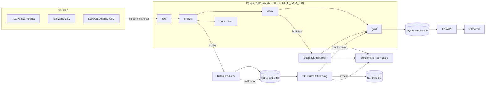

# Implementation Plan — NYC MobilityPulse

**Project:** NYC MobilityPulse: Scalable Taxi Demand Forecasting and Mobility Anomaly Detection
**Team:** The Petabyte Pack — Mohammad Ayan Khan, K Srikar Siddarth, Chandana N, Ritesh T Patil
**Course:** DA231O Data Engineering at Scale (IISc)
**Source requirements:** `Project/Project Requirement Document V2.docx` (PRD V2), `Project/NYC MobilityPulse - Detailed Project Proposal.md`
**Status:** APPROVED 2026-11-07 — implemented (see Section 12 for the recorded decisions and [README.md](README.md) to run it)

---

## 0. What this plan adds to PRD V2 (reviewer feedback)

> **Key improvement requested:** *"Provide explicit numerical targets for streaming latency and model accuracy benchmarks in the final evaluation."*

PRD V2 §3.2/§3.3 only says "stable streaming latency" and "forecast accuracy (MAE, RMSE, MAPE)". This plan replaces those with **measurable pass/fail targets** (Section 6), each with:

1. a precise metric definition,
2. the exact measurement method / code location,
3. the reference workload and hardware it applies to,
4. a numeric threshold, and
5. a baseline it is compared against.

Every target is emitted automatically into `results/evaluation_scorecard.md` (PASS/FAIL per row) so the final report cannot drift from the code.

---

## 1. Scope

### 1.1 Mandatory (graded) scope
| # | Capability | Platform |
|---|---|---|
| F1 | Reproducible ingestion + manifest + validation of TLC Yellow, Taxi Zones, NOAA ISD | Python + PySpark |
| F2 | Layered Parquet lake: raw → bronze → silver → gold, quarantine for rejects | Parquet |
| F3 | Spark SQL batch analytics + weather enrichment + zone-hour feature table | Spark SQL / DataFrames |
| F4 | Kafka replay producer (rate-controlled, malformed-event injection) | Kafka |
| F5 | Structured Streaming: windowed zone metrics, watermark, checkpoints, DLQ | Spark Structured Streaming |
| F6 | Next-hour zone demand forecasting (LR, RF, GBT + naive baselines) | Spark ML |
| F7 | Anomaly detection (rule-based MAD labels, residual detector, KMeans distance) | Spark ML + SQL |
| F8 | Serving: FastAPI (REST) + Streamlit dashboard over gold tables | FastAPI, Streamlit, SQLite |
| F9 | Benchmark harness + evaluation scorecard with numeric targets | Python |

### 1.2 Stretch (only after mandatory scope passes)
Green taxi data, multi-station weather, MongoDB serving sink, 2-worker standalone Spark cluster in Docker, AWS EC2 run.

### 1.3 Non-goals
Real-time production taxi feed, deep-learning models, geospatial map tiles, paid cloud services.

---

## 2. Architecture



**Execution modes**
1. **Local (canonical, graded):** Spark `local[*]`, Kafka via `docker compose` (single KRaft broker), data dir outside OneDrive.
2. **Stretch:** Spark standalone master + 2 workers in Docker Compose for the parallelism experiment.

---

## 3. Repository layout (to be created under `Complete_Project_Implementation/`)

```text
Complete_Project_Implementation/            (as built)
├── Plan.md, Data_Pipeline_and_Layers.md, README.md
├── pyproject.toml, requirements.txt, Makefile
├── configs/config.yaml               # central config (env override MP__SECTION__KEY)
├── configs/targets.yaml              # Section 6 targets, evaluated by the scorecard
├── infra/
│   ├── docker-compose.yml            # Kafka 3.7 KRaft broker, topic-init, optional Kafka UI
│   ├── kafka/Dockerfile, create-topics.sh
│   └── spark-defaults.conf
├── src/mobilitypulse/
│   ├── common/      config.py, spark.py, utils.py (IO, timing, months, holidays, measurements)
│   ├── ingestion/   download.py (idempotent + manifest), sample.py (synthetic raw data)
│   ├── batch/       bronze.py, quality.py, silver.py, demand.py, features.py, analytics.py
│   ├── streaming/   producer.py, stream_job.py (incl. latency + progress logging)
│   ├── ml/          train.py (baselines + LR/RF/GBT), metrics.py, anomaly.py
│   ├── serving/     export.py (gold → SQLite), queries.py, api.py (FastAPI), dashboard.py (Streamlit)
│   ├── benchmark/   harness.py, batch_bench.py (E1–E5), stream_bench.py (E6–E9), scorecard.py
│   └── cli.py       # --stage sample|ingest|bronze|silver|demand|features|analytics|ml|anomaly|export|scorecard|all|demo
├── scripts/run_pipeline.py, record_measurement.py
├── tests/unit/, tests/integration/   # synthetic data generated on the fly (no committed fixtures needed)
├── docs/
│   ├── 01_architecture.md            # components, module map, design decisions
│   ├── 02_streaming.md               # event model, topics, watermark, semantics, latency method
│   ├── 03_ml_and_anomaly.md          # features, split, models, baselines, anomaly method
│   ├── 04_evaluation.md              # targets, experiments, how to reproduce each number
│   ├── 05_runbook.md                 # setup, troubleshooting (OneDrive, Java, Kafka, Colima)
│   └── 06_viva_guide.md              # ownership, demo script, likely questions
└── results/                          # measurements.json, evaluation_scorecard.md, dq/, benchmarks/, stream/
```

Data contracts, batch stages and serving tables are documented in [Data_Pipeline_and_Layers.md](Data_Pipeline_and_Layers.md).

Large data is **never** committed; `data/` is git-ignored and relocatable via `MOBILITYPULSE_DATA_DIR` (recommended: `~/mobilitypulse_data`, outside OneDrive, to avoid sync locking Spark/Kafka files).

---

## 4. Component design (summary — full detail goes into `docs/`)

Source data, every pipeline step and each layer's output schema are detailed in [Data_Pipeline_and_Layers.md](Data_Pipeline_and_Layers.md).

### 4.1 Ingestion (F1)
- Idempotent downloader: skips files already present with matching size/SHA-256; writes `raw/_manifest.parquet` (url, file, month, bytes, sha256, downloaded_at, status).
- NOAA ISD `global-hourly` station 72505394728 (Central Park): parse `TMP`, `AA1` (precip), `WND`, `VIS` encoded fields, scale factors and `9999` missing codes; resample to hourly in `America/New_York`.

### 4.2 Bronze / Quality / Silver (F2, F3)
- Bronze: canonical trip schema (PRD proposal §7.2), `record_id`, `source_file`, `source_month`; partitioned by `source_month`; **no rows dropped**.
- Quality rules from `config.yaml › quality` (duration 1–360 min, distance ≤ 200 mi, fare ≤ $1000, passengers ≤ 9, zone 1–263, speed ≤ 100 mph, pickup within source month, dedupe on deterministic record hash) are applied in the bronze → silver step. Rejects → `quarantine/` with `reject_reason`.
- DQ report per run: `input = valid + rejected` reconciliation, null counts, duplicate counts.
- Silver: zone-hour aggregates (pickups, dropoffs, avg distance/duration/fare) joined with **broadcast** zone dim and hourly weather.
- Spark SQL analytics (gold): pickups by zone×hour, top zones by day/weekday, duration by weather bucket, borough fare/distance summary, demand volatility.

### 4.3 Features (F3)
Dense zone×hour grid (zero-filled), lags `[1,2,3,24,168]`, rolling means `[3,24]`, calendar (hour, dow, weekend, US holiday), weather, label = `trip_count(t+1)`. Zones with < 500 trips in range excluded from ML.

### 4.4 Streaming (F4, F5)
- Producer: reads bronze month, emits JSON keyed by `pickup_zone_id`, rate-limited (`events_per_second`) or time-scaled (`speedup`), injects `malformed_fraction` bad events, stamps `produced_at_ms`.
- Stream job: Kafka source (`maxOffsetsPerTrigger`), explicit schema, validation → DLQ topic, watermark 2 h, sliding window 1 h / 15 min by zone, broadcast zone join, **update** mode to Parquet/foreachBatch sink with checkpoint; trigger 5 s.
- Latency: `foreachBatch` records `sink_commit_ms − max(Kafka append ts)` for every updated window, plus `StreamingQueryProgress` (input/processed rate, trigger duration, Kafka backlog) to `results/stream/*.csv` (method: [docs/02_streaming.md](docs/02_streaming.md)).

### 4.5 ML (F6) and Anomaly (F7)
- Time-based split: train = all but last 21 days; validation = next 7; test = last 14 (no shuffling across time).
- Models: Linear Regression, Random Forest, GBT (Spark ML `Pipeline`: `StringIndexer`/`OneHotEncoder` for borough, `VectorAssembler`). Hyper-params from config; light grid search on validation only.
- Baselines (non-ML, for relative targets): **persistence** ŷ(t+1)=y(t) and **seasonal-naive** ŷ(t+1)=y(t+1−168).
- Anomaly: (a) rule labels = robust z (MAD vs same zone×hour-of-week history) ≥ 3.5; (b) residual detector |standardised GBT residual| ≥ 3.0; (c) KMeans (k=8) distance > 99.5th pct. Evaluated on rule labels **and** on synthetically injected spikes/drops (2 % of test rows with forecast ≥ 20, ×3 / ×0.2 magnitude, seed 7) where ground truth is known.

### 4.6 Serving (F8)
FastAPI: `/health`, `/zones`, `/demand`, `/forecast`, `/anomalies`, `/metrics/latest`, `/stream/latest`. Streamlit: zone×hour heatmap, forecast vs actual, anomaly table, live streaming panel (auto-refresh), benchmark charts. API reads precomputed SQLite (no Spark on request path).

---

## 5. Reference environment (all targets are stated against this)

| Item | Value |
|---|---|
| Hardware | Team laptop, ≥ 8 CPU cores, 16 GB RAM, SSD (exact spec auto-recorded in `results/env.json`) |
| Software | Python 3.11, Java 17, PySpark 3.5.3, Kafka 3.7.1 (KRaft, 1 broker), Colima + docker compose |
| Spark | `local[*]`, driver memory 6 GB, AQE on, shuffle partitions 32 (varied in experiments) |
| Dataset S / M / L | S = 2024-01 (~3 M trips) · M = 2024-01..03 (~9.5 M) · L = 2024-01..06 (~20 M) — **approved: laptop-friendly sizes** |
| Stream workload | Replay of 2024-01, 4 Kafka partitions, trigger 5 s, 10-minute sustained run after 1-min warm-up |

> Decision: S/M/L kept at 1 / 3 / 6 months (config `datasets`). Larger runs remain possible with `--months`.

---

## 6. Evaluation targets (explicit numerical benchmarks)

Status codes in the scorecard: **PASS** (meets target), **FAIL** (with root-cause note). Targets are fixed now, before results are seen.

### 6.1 Streaming latency and throughput

| ID | Metric (definition) | Target | Measured by |
|---|---|---|---|
| S1 | End-to-end latency p50 = `sink_commit_ts − kafka_record_ts`, sustained 2,000 ev/s | **≤ 5 s** | `latency_probe.py` |
| S2 | End-to-end latency p95 at 2,000 ev/s | **≤ 10 s** | `latency_probe.py` |
| S3 | End-to-end latency p99 at 2,000 ev/s | **≤ 15 s** | `latency_probe.py` |
| S4 | Micro-batch duration ≤ trigger interval (5 s) | **≥ 95 % of batches** | `StreamingQueryProgress` |
| S5 | Sustained processing rate (no lag growth over 10 min) | **≥ 10,000 ev/s** (5× nominal) | `streaming_bench.py` rate sweep 1k→20k ev/s |
| S6 | Consumer lag at 2,000 ev/s after warm-up | **≤ 1 trigger of events (≤ 10,000) and non-increasing** | Kafka offsets vs committed |
| S7 | p95 latency at 4 vs 1 Kafka partitions under 10k ev/s | **≥ 30 % lower with 4 partitions** | partition sweep {1,2,4,8} |
| S8 | Checkpoint recovery time (kill → first new batch committed) | **≤ 30 s** | `recovery.py` |
| S9 | Recovery correctness: completed-window counts after restart vs uninterrupted run | **100 % match, 0 lost / 0 duplicate** | `recovery.py` |
| S10 | Malformed events routed to DLQ (1 % injected) | **100 % routed, 0 valid events dropped** | DLQ count vs injected count |
| S11 | Stream vs batch agreement for closed 1-h windows (same month) | **100 % exact count match** | `streaming_bench.py` reconciliation |

Note: event-time *window finality* is bounded by the 2 h watermark by design; S1–S3 measure the freshness of the **live (update-mode) metric**, which is what the dashboard shows. Both are documented in `docs/04_streaming.md`.

### 6.2 Forecast accuracy (test split = last 14 days, zone-hours of eligible zones)

| ID | Metric | Target | Baseline compared |
|---|---|---|---|
| M1 | MAE of best model (expected GBT) | **≥ 20 % lower than seasonal-naive MAE** and **≥ 30 % lower than persistence MAE** | baselines.py |
| M2 | MAE (absolute, trips per zone-hour) | **≤ 6.0** | — |
| M3 | RMSE | **≤ 12.0** | — |
| M4 | WAPE = Σ\|y−ŷ\| / Σy (robust to zero-demand hours) | **≤ 20 %** | — |
| M5 | MAPE on zone-hours with y ≥ 10 | **≤ 25 %** | — |
| M6 | R² | **≥ 0.90** | — |
| M7 | GBT beats Linear Regression on MAE | **≥ 10 % lower** | LR in same run |
| M8 | Worst-borough WAPE (Manhattan/Queens/Brooklyn/Bronx) | **≤ 35 %** (no hidden failure segment) | evaluate.py by-group |
| M9 | Peak-hour (07–10, 16–20 weekdays) WAPE | **≤ 22 %** | evaluate.py by-group |

### 6.3 Anomaly detection

| ID | Metric | Target |
|---|---|---|
| A1 | Recall on injected anomalies (residual detector) | **≥ 0.80** |
| A2 | Precision on injected anomalies | **≥ 0.70** |
| A3 | F1 on injected anomalies | **≥ 0.75** |
| A4 | Precision / recall vs rule-based MAD labels on real data | **≥ 0.60 / ≥ 0.60** |
| A5 | Alert rate on un-injected test data | **≤ 1 % of zone-hours** (operator-friendly) |

### 6.4 ML operational

| ID | Metric | Target |
|---|---|---|
| O1 | GBT training time on M features | **≤ 15 min** |
| O2 | Batch inference throughput | **≥ 100,000 rows/s** |
| O3 | Feature build time on M | **≤ 10 min** |

### 6.5 Batch performance and scalability

| ID | Metric | Target |
|---|---|---|
| B1 | S end-to-end batch (bronze → features) wall-clock | **≤ 3 min** |
| B2 | Bronze→silver throughput on M | **≥ 250,000 records/s** |
| B3 | Data-scaling efficiency `(T_S × k) / T_kS` for S→M and M→L | **≥ 0.75** (near-linear; overheads explained) |
| B4 | Broadcast vs sort-merge join for zone dim | **≥ 1.2× faster with broadcast** + shuffle-bytes reduction reported |
| B5 | Cached vs uncached reused silver DataFrame (multi-query) | **≥ 1.5× faster cached** |
| B6 | Partition sweep {8,16,32,64,128,256} | Optimum identified; report U-shape with task-overhead explanation |
| B7 | Parquet vs CSV scan of same month (column-pruned query) | **≥ 3× faster Parquet**, size ratio reported |

### 6.6 Data quality and reproducibility

| ID | Metric | Target |
|---|---|---|
| D1 | Reconciliation `input − valid − rejected` | **= 0 for every month** |
| D2 | Rejection rate per month | Reported; alert if **> 8 %** |
| D3 | Duplicate trips in silver | **0** |
| D4 | Fresh clone → sample end-to-end (`make setup sample batch ml serve`) | **≤ 30 min, 0 manual steps beyond README** |
| D5 | Test suite | **100 % pass; ≥ 70 % line coverage on `src/`** |

**If a target FAILS**, the report must state the measured value, root cause (with Spark UI / metrics evidence) and the remediation attempted — no target is silently dropped.

---

## 7. Experiment matrix

| Exp | Variable(s) | Values | Fixed | Outputs |
|---|---|---|---|---|
| E1 Data scaling | input size | S, M, L | partitions 32 | runtime, rows/s, shuffle R/W → B1–B3 |
| E2 Partitions | `spark.sql.shuffle.partitions` | 8…256 | M | runtime, task count, spill → B6 |
| E3 Join strategy | broadcast on/off | 2 | M | runtime, shuffle bytes → B4 |
| E4 Caching | cache on/off | 2 | M, 5 queries | runtime → B5 |
| E5 Format | Parquet vs CSV | 2 | S | runtime, size → B7 |
| E6 Stream rate | events/s | 1k, 2k, 5k, 10k, 15k, 20k | 4 partitions | latency pXX, proc rate, lag → S1–S6 |
| E7 Kafka partitions | partitions | 1, 2, 4, 8 | 10k ev/s | latency, proc rate → S7 |
| E8 Recovery | kill at random batch | 3 trials | 2k ev/s | recovery s, reconciliation → S8–S9 |
| E9 DLQ | malformed fraction | 0, 1 %, 5 % | 2k ev/s | DLQ counts → S10 |
| E10 Models | model type | naive×2, LR, RF, GBT | test split | M1–M9, O1–O2 |
| E11 Anomaly | detector | MAD, residual, KMeans | injected + real | A1–A5 |
| E12 (stretch) Workers | executors | 1 vs 2 workers | M | runtime |

Each experiment runs **3 repetitions**; reported value = median, with min/max. Results in `results/*.csv`, plots in `results/plots/`.

---

## 8. Testing strategy
- **Unit:** timestamp/tz conversion, NOAA field decoding, DQ rule classification, feature lags, event (de)serialisation, deterministic IDs, metric functions (WAPE, MAPE masking).
- **Contract:** schema of each layer, row reconciliation, join preserves row counts.
- **Integration:** fixture → bronze → silver → features → tiny GBT → gold → SQLite → API `TestClient`; streaming with Spark file/rate source (no Kafka needed in CI); Kafka path tested manually via `make stream-demo`.

---

## 9. Documentation deliverables
`README.md` + `docs/01…09` (Section 3), auto-generated `results/evaluation_scorecard.md`, final report (PDF) built from docs + scorecard, architecture diagrams (Mermaid), demo script, viva guide with per-member walkthrough.

---

## 10. Implementation phases (mapped to PRD V2 timeline)

| Phase | PRD week | Work | Exit criterion | Proposed owner |
|---|---|---|---|---|
| P1 | 1 | Scaffold repo, config loader, Spark session factory, fixtures, Makefile, docker-compose (Kafka) | `make test` green; Spark reads fixture | Ritesh T Patil |
| P2 | 2 | Downloader + manifest, NOAA parser, bronze, DQ + quarantine | D1 = 0 for 2024-01 | Mohammad Ayan Khan |
| P3 | 3 | Silver, Spark SQL analytics, features | Batch reproducible from CLI | K Srikar Siddarth |
| P4 | 4 | Benchmark harness, E1–E5 | B1–B7 measured | K Srikar Siddarth |
| P5 | 5 | Producer, stream job, DLQ, latency probe | Live metrics update during replay | Chandana N |
| P6 | 6 | Baselines, LR/RF/GBT, anomaly detectors, E10–E11 | M1–M9, A1–A5 measured | Ritesh T Patil |
| P7 | 7 | Export, FastAPI, Streamlit, E6–E9 | End-to-end demo; S1–S11 measured | Chandana N / Mohammad Ayan Khan |
| P8 | 8 | Scorecard, docs, report, clean-clone test (D4), viva guide | All docs consistent with scorecard | All |

Owners are a proposal — please confirm or reassign. I (the assistant) will implement all code; owners are for review/viva accountability.

---

## 11. Risks and mitigations
| Risk | Mitigation |
|---|---|
| OneDrive syncing/locking Spark & Kafka files | Data + checkpoints under `MOBILITYPULSE_DATA_DIR` outside OneDrive; path with trailing space handled by quoting |
| Laptop RAM insufficient for L | Process month-by-month, partition by date; documented fallback L |
| Kafka/Docker unavailable | Streaming tests also run with Spark `rate`/file source; Kafka run documented separately |
| Accuracy targets missed | Baselines + segment analysis explain why; tuning on validation only; report honestly |
| NOAA format quirks | Single station, unit-tested decoder, forward-fill ≤ 3 h gaps |
| Zone skew (Manhattan) | Measure task-time skew in E2; AQE skew join; report |

---

## 12. Recorded decisions (2026-11-07)

1. **Targets (Section 6):** approved as written; editable in `configs/targets.yaml` without code changes.
2. **Dataset sizes:** 1 / 3 / 6 months (laptop-friendly).
3. **Serving store:** SQLite.
4. **Kafka runtime:** Colima + docker compose plugin; single KRaft broker (`infra/docker-compose.yml`, `infra/kafka/Dockerfile`).
5. **Owners:** as in Section 10.
6. **Location:** code in `Complete_Project_Implementation/`, data in `~/mobilitypulse_data`; synthetic demo data in `~/mobilitypulse_sample`.
7. **Toolchain installed:** OpenJDK 17, Python 3.11 venv `~/.venvs/mp311`, docker-compose plugin.
8. **Anomaly injection:** 2 % of test zone-hours with forecast ≥ 20 (0.2 % in the draft gave too few positives for a stable precision estimate).
9. **Scope of this delivery:** code + tests (61 passing, 82 % coverage) and a synthetic end-to-end demo; real-data downloads and the benchmark runs are executed by the team with `make pipeline`, `make bench-batch`, `make bench-stream`, `make scorecard`.
