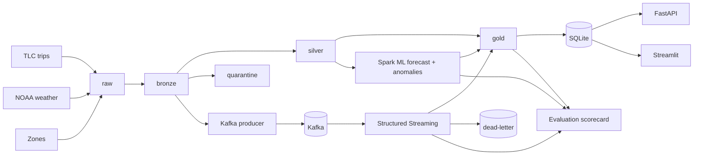

# NYC MobilityPulse

> **Windows users:** see [README_WINDOWS.md](README_WINDOWS.md) for setup and [RUN_WINDOWS.md](RUN_WINDOWS.md) for run steps (`setup_windows.ps1` + `.\mp.cmd <task>` instead of `make`).

**Scalable Taxi Demand Forecasting and Mobility Anomaly Detection**
DA231O Data Engineering at Scale (IISc) · Team **The Petabyte Pack** — Mohammad Ayan Khan, K Srikar Siddarth, Chandana N, Ritesh T Patil

MobilityPulse ingests public NYC TLC taxi trips, NOAA weather and the taxi-zone lookup into a layered Parquet lake
(raw → bronze → silver → gold), runs Spark SQL analytics, forecasts next-hour pickups per zone with Spark ML,
detects anomalous zone-hours, replays trips through Kafka into Spark Structured Streaming, and serves everything
through a FastAPI service and a Streamlit dashboard. Every evaluation target from the plan is measured and
written to an auto-generated PASS/FAIL scorecard.



| Document | Content |
|---|---|
| [Plan.md](Plan.md) | Approved plan, scope, numeric targets, experiment matrix |
| [Data_Pipeline_and_Layers.md](Data_Pipeline_and_Layers.md) | Source data, every step, schema of every layer |
| [docs/01_architecture.md](docs/01_architecture.md) | Components, module map, key design decisions |
| [docs/02_streaming.md](docs/02_streaming.md) | Kafka + Structured Streaming design, semantics, latency method |
| [docs/03_ml_and_anomaly.md](docs/03_ml_and_anomaly.md) | Features, split, models, baselines, anomaly detectors |
| [docs/04_evaluation.md](docs/04_evaluation.md) | Targets, how each number is produced, experiments |
| [docs/05_runbook.md](docs/05_runbook.md) | Setup, commands, troubleshooting |
| [docs/06_viva_guide.md](docs/06_viva_guide.md) | Ownership, walkthrough script, likely questions |
| `results/evaluation_scorecard.md` | Generated PASS / FAIL / NOT RUN table for every target (`make scorecard`) |

---

## 1. Prerequisites (macOS, Apple Silicon)

| Tool | Version | Why | Install |
|---|---|---|---|
| Homebrew | any | package manager | https://brew.sh |
| Java | **17** | Spark runs on the JVM | `brew install openjdk@17` |
| Python | **3.11** | PySpark 3.5 does not support Python 3.13/3.14 | `brew install python@3.11` |
| Docker runtime | Colima + docker CLI + compose plugin | Kafka runs in a container | `brew install colima docker docker-compose` |
| Disk | ~3 GB free | 6 months of TLC data + all layers | — |
| RAM | 16 GB recommended | Spark driver 6 GB + Kafka VM 6 GB | — |

One-time Docker setup so that `docker compose` finds the Homebrew plugin — add this key to `~/.docker/config.json`
(merge it if the file already exists):

```json
{ "cliPluginsExtraDirs": ["/opt/homebrew/lib/docker/cli-plugins"] }
```

Check: `docker compose version` should print a version.

## 2. Install

All commands are run from this folder (`Complete_Project_Implementation/`).

```bash
make setup        # creates ~/.venvs/mp311 (Python 3.11) and installs the package + dev tools
make help         # lists every make target
```

The Makefile sets `JAVA_HOME=/opt/homebrew/opt/openjdk@17/libexec/openjdk.jdk/Contents/Home` and uses the venv
automatically — no `source activate` needed. To use the venv by hand: `source ~/.venvs/mp311/bin/activate`.

## 3. Verify the installation (no internet, no Docker)

```bash
make test-fast    # unit tests only, ~25 s
make test         # all 87 tests incl. Spark integration on synthetic data, ~3.5 min, coverage -> results/tests/
make demo         # synthetic data through every stage in ~1 min, written to ~/mobilitypulse_sample
```

`make demo` prints a timing line per stage ending with `finished: {...}`. It refuses to write into the real data
directory, so synthetic and real data never mix.

## 4. Run the batch pipeline on real data

Real data is stored **outside OneDrive** in `~/mobilitypulse_data` (change with `MOBILITYPULSE_DATA_DIR`).
Month sets are defined in `configs/config.yaml › datasets`: `small` = 2024-01, `medium` = 2024-01..03 (default),
`large` = 2024-01..06. Any range also works, e.g. `MONTHS=2024-04..2024-05`.

**Option A – everything in one command**

```bash
make pipeline MONTHS=medium      # ingest -> bronze -> silver -> demand -> features -> analytics -> ml -> anomaly -> export
```

**Option B – step by step (recommended the first time)**

| # | Command | What it does | Verified result (2024-01..03 on the reference laptop) |
|---|---|---|---|
| 1 | `make ingest MONTHS=large` | downloads TLC months, zone lookup, NOAA year; skips unchanged files | 6 × 48–60 MB Parquet, 6.2 MB NOAA CSV, ~4 min |
| 2 | `make bronze MONTHS=large` | canonical typed schema, lineage, no rows dropped | 20,332,093 trips in 28 s |
| 3 | `make silver MONTHS=medium` | quality rules, quarantine, DQ report, hourly weather | 9.55 M input, 4.4–4.8 % rejected, reconciliation diff 0, 41 s |
| 4 | `make demand MONTHS=medium` | dense zone × hour grid + weather | 574,392 rows, trip reconciliation diff 0, 8 s |
| 5 | `make features MONTHS=medium` | lags, rolling means, calendar, label, time split | 157 eligible zones; train 237 k / val 26 k / test 53 k rows |
| 6 | `make analytics MONTHS=medium` | six Spark SQL gold tables | 7 s–12 s |
| 7 | `make ml` | baselines + linear regression, random forest, GBT + validation-weighted ensemble | ~4 min; best model on validation chosen automatically (ensemble 0.7 LR + 0.3 GBT) |
| 8 | `make anomaly` | residual / MAD / KMeans detectors + injected evaluation | ~1,500 anomalies flagged |
| 9 | `make export` | gold -> `~/mobilitypulse_data/serving/mobilitypulse.db` | 12 tables |

Outputs to look at: `results/dq/dq_report_2024-01.json`, `results/measurements.json`, and the Spark UI at
http://localhost:4040 while a stage runs.

## 5. Run streaming (Kafka + Spark Structured Streaming)

Needs the bronze layer for 2024-01 (step 2 above).

```bash
colima start --cpu 4 --memory 6        # start the Docker VM (once per boot)
make kafka-up                          # builds the topic-init image, starts Kafka, creates topics
make kafka-topics                      # expect taxi-trips (4 partitions) and taxi-trips-dlq (1 partition)
```

Then use **two terminals**:

```bash
# terminal 1 – the streaming job (keeps running; Ctrl+C to stop). First run downloads the
# spark-sql-kafka connector from Maven (~1 min). Spark UI -> "Structured Streaming" tab on :4040
make stream

# terminal 2 – replay real January trips into Kafka (defaults: 2,000 events/s, 200,000 trips, 1 % malformed)
make produce
make produce RATE=5000 MAX=500000      # optional: other rate / size
```

What to expect (verified): ~20 micro-batches for 200 k events, Kafka backlog 0, malformed events in
`~/mobilitypulse_data/quarantine/stream_dlq` and Kafka topic `taxi-trips-dlq`, window metrics in
`~/mobilitypulse_data/gold/stream_zone_metrics`, latency logs in `results/stream/`.
After stopping the job, `make export` makes the results visible on the dashboard's **Live stream** page.

Notes
* The job resumes from its checkpoint on restart. To start clean:
  `~/.venvs/mp311/bin/python -m mobilitypulse.streaming.stream_job --reset`
* Optional Kafka web UI: `make kafka-ui` -> http://localhost:8080
* Stop everything: `make kafka-down && colima stop`

Kafka files: [infra/docker-compose.yml](infra/docker-compose.yml) (KRaft broker, topic-init, optional UI),
[infra/kafka/Dockerfile](infra/kafka/Dockerfile) and [infra/kafka/create-topics.sh](infra/kafka/create-topics.sh).

## 6. API and dashboard

Run `make export` first (after the batch pipeline and, optionally, streaming). Both servers listen on
**localhost only**.

```bash
make api          # FastAPI   -> http://127.0.0.1:8000/docs (interactive Swagger UI)
make dashboard    # Streamlit -> http://127.0.0.1:8501
```

| API endpoint | Example |
|---|---|
| `GET /health` | table row counts |
| `GET /zones?borough=Manhattan` | zone list |
| `GET /demand?zone_id=161&start=2024-03-20T07:00:00&end=2024-03-20T10:00:00` | hourly demand |
| `GET /forecast?zone_id=132` | actual vs predicted (best model, test period) |
| `GET /anomalies?severity=high&limit=20` | anomalies ordered by strength |
| `GET /metrics/latest` | forecast + anomaly evaluation metrics |
| `GET /stream/latest?zone_id=161` | latest streaming windows |
| `GET /analytics/{demand_profile,top_zones_daily,weather_impact,borough_summary,zone_volatility,od_flows}` | gold tables |
| `GET /data-quality?alerts_only=true` | daily row counts, null rates, rejects by reason, freshness, alert flags |

Dashboard pages: Overview · Demand heatmap · Forecast vs actual · Anomalies · Weather impact · Data quality ·
Live stream · Benchmarks & scorecard.

To view the synthetic demo instead of real data, prefix the command:
`MOBILITYPULSE_DATA_DIR=~/mobilitypulse_sample make dashboard`.

## 7. Evaluation (benchmarks + scorecard)

Run these when the laptop is otherwise idle — they measure performance.

| Order | Command | Needs | Duration | Targets |
|---|---|---|---|---|
| 1 | `make pipeline MONTHS=medium` and `make bronze MONTHS=large` | internet | ~10 min | D1–D3, M*, A*, O* |
| 2 | `make bench-stream` | Kafka running | ~35 min | S1–S11 |
| 3 | `make bench-batch` | bronze for `large` | ~20 min | B1–B7, O3 |
| 4 | `make test` | — | ~1 min | D5 |
| 5 | `make scorecard` | — | seconds | writes `results/evaluation_scorecard.md` |

Single streaming experiments: `~/.venvs/mp311/bin/python -m mobilitypulse.benchmark.stream_bench main|rates|partitions|recovery`;
single batch experiments: `... -m mobilitypulse.benchmark.batch_bench e1 e3`.
Targets are fixed in [configs/targets.yaml](configs/targets.yaml); every FAIL must be explained in the report
(see [docs/04_evaluation.md](docs/04_evaluation.md)).

### 7.1 Extras: Spark internals pack, incremental runs, daily data quality

```bash
make concepts                              # lazy evaluation, narrow/wide, skew, silver-vs-gold -> results/concepts/
make incremental MONTHS=2024-01..2024-06   # only new / unfinished / changed months; state in <data_dir>/state/
MP__ML__TUNING__ENABLED=true make ml       # optional validation-only GBT grid search (off by default)
```

See [docs/07_spark_internals.md](docs/07_spark_internals.md) and
[docs/08_incremental_and_dq.md](docs/08_incremental_and_dq.md). The silver stage now also writes
`gold/data_quality_daily` (shown on the dashboard's **Data quality** page). Root causes of the FAILs that were
investigated are in [docs/04_evaluation.md](docs/04_evaluation.md) §6.

## 8. Configuration

All settings are in [configs/config.yaml](configs/config.yaml). Any value can be overridden for one command with an
environment variable `MP__<SECTION>__<KEY>`:

```bash
MP__SPARK__DRIVER_MEMORY=8g MP__SPARK__SHUFFLE_PARTITIONS=64 make silver MONTHS=medium
MP__PRODUCER__MALFORMED_FRACTION=0.05 make produce
MOBILITYPULSE_DATA_DIR=/Volumes/ssd/mp make pipeline
```

Most-used keys: `datasets.*`, `spark.driver_memory`, `spark.shuffle_partitions`, `quality.*` (rule thresholds),
`ml.models` / `ml.test_days`, `anomaly.*`, `producer.events_per_second`, `streaming.trigger`,
`streaming.shuffle_partitions`, `kafka.partitions`.

## 9. Verification status (2026-11-07, reference laptop: 10-core Apple Silicon, 16 GB)

| Part | Tested how | Result |
|---|---|---|
| Unit + integration tests | `make test` | all pass, ~82 % line coverage |
| Ingestion | real downloads through the corporate proxy | OK (idempotent, HTML/redirect pages rejected) |
| Batch pipeline | real 2024-01..03 (9.55 M trips) | all reconciliation checks exactly 0 |
| Forecasting | real test period (last 14 days of March) | MAE 4.76, RMSE 12.1, WAPE 16.5 %, R² 0.97, 38.6 % better than persistence; see [docs/03](docs/03_ml_and_anomaly.md) for the improvement log |
| Anomaly detection | real data + injected anomalies | precision 0.66, recall 0.90, F1 0.76, alert rate 0.78 % |
| Kafka + streaming | real 200 k trips at 2,000 ev/s | 100 % DLQ routing, 0 events lost, 100 % match with batch; p50 4.7 s / p95 7.7 s after tuning |
| API + dashboard | every endpoint and page against the real DB | OK |
| Benchmarks | `make bench-stream`, `MP__SPARK__DRIVER_MEMORY=10g make bench-batch` (2026-11-17) | 30 PASS / 14 FAIL / 1 INFO / 0 NOT RUN, see `results/evaluation_scorecard.md`; every FAIL explained in `report/` |
| Two-year run | 2022-07..2024-06 (78.5 M trips) on a second machine | see `results_two_years/evaluation_scorecard.md` and `comparison_3m_vs_2y.csv` |

## 10. Troubleshooting (short — full list in [docs/05_runbook.md](docs/05_runbook.md))

| Symptom | Fix |
|---|---|
| `SSLCertVerificationError` during `make ingest` | corporate TLS proxy (Zscaler): handled automatically via `truststore` (uses the macOS keychain); re-run `make setup` if `truststore` is missing |
| NOAA file only a few KB / HTML | old NOAA URL; config now uses the AWS Open Data bucket — re-run `make ingest` |
| `Unable to locate a Java Runtime` | `brew install openjdk@17` (Makefile sets `JAVA_HOME`) |
| `docker: unknown command: docker compose` | add `cliPluginsExtraDirs` (section 1) |
| `Cannot connect to the Docker daemon` | `colima start` |
| Streaming latency high | keep `streaming.shuffle_partitions` at 8; restart the job with `--reset` after changing it |
| Port 4040/8000/8501 busy | another Spark job / server is running; stop it or change `MP__SPARK__UI_PORT` |

## 11. Repository layout

```text
configs/            config.yaml (all tunables), targets.yaml (evaluation targets)
infra/              docker-compose.yml (Kafka), kafka/Dockerfile + create-topics.sh, spark-defaults.conf
src/mobilitypulse/
  common/           config, Spark session factory, IO/timing/measurement helpers
  ingestion/        download.py (idempotent + manifest + content checks), sample.py (synthetic raw data)
  batch/            bronze.py, quality.py, silver.py, demand.py, features.py, analytics.py,
                    dq_daily.py (gold.data_quality_daily), incremental.py (state table, watermark)
  ml/               train.py (baselines + LR/RF/GBT), anomaly.py, metrics.py
  streaming/        producer.py (Kafka replay), stream_job.py (Structured Streaming)
  serving/          export.py (gold -> SQLite), queries.py, api.py (FastAPI), dashboard.py (Streamlit)
  benchmark/        harness.py, batch_bench.py, stream_bench.py, concepts.py (Spark internals), scorecard.py
  cli.py            pipeline entry point (python -m mobilitypulse.cli --stage ...)
scripts/            run_pipeline.py, record_measurement.py
tests/              unit/ and integration/ (pytest -m "not integration" for the fast subset)
results/            measurements.json, evaluation_scorecard.md, dq/, benchmarks/, stream/ (generated)
results_two_years/  two-year run (other machine): measurements, scorecard, DQ reports, model/anomaly metrics, run log
report/             final report (MobilityPulse_Report.docx / .md), figures/, make_figures.py
```

Data directory (`~/mobilitypulse_data`): `raw/ bronze/ silver/ gold/ quarantine/ models/ checkpoints/ state/ serving/ bench/`
— see [Data_Pipeline_and_Layers.md](Data_Pipeline_and_Layers.md) §9.

## 12. Data sources and licences

NYC TLC Trip Record Data and Taxi Zone Lookup (NYC Open Data, public); NOAA Integrated Surface Database, station
725053-94728 Central Park, via the NOAA AWS Open Data bucket `noaa-global-hourly-pds` (public domain).
No proprietary data is used and raw data is never committed.


## 13. Distributed mode: Spark standalone cluster + MinIO (SetupF)

Everything above runs Spark as `local[*]` on one machine. The same code also runs on a Spark standalone cluster with
the data lake on an S3-compatible store (MinIO), so executors on other machines read and write the data:

```bash
cp setupF.env.example setupF.env           # MASTER_IP, S3_ENDPOINT, S3_ACCESS_KEY, S3_SECRET_KEY, memory, cores
make cluster-check CLUSTER=1                 # Windows: .\mp.cmd check -Cluster
make pipeline MONTHS=medium CLUSTER=1        # Windows: .\mp.cmd pipeline -Months medium -Cluster
```

`CLUSTER=1` / `-Cluster` selects the `setupf` profile (`configs/profile_setupf.yaml`): `paths.data_dir` becomes
`s3a://lake/mobilitypulse`, `spark.master` becomes `spark://<MASTER_IP>:7077`. Downloads, the pipeline state table and the
serving DB stay on the driver machine. Benchmarks, `concepts` and the test suite always run locally. The full
procedure for the two Azure VMs is in `RunMobilityPulse_SetupF.md`.
