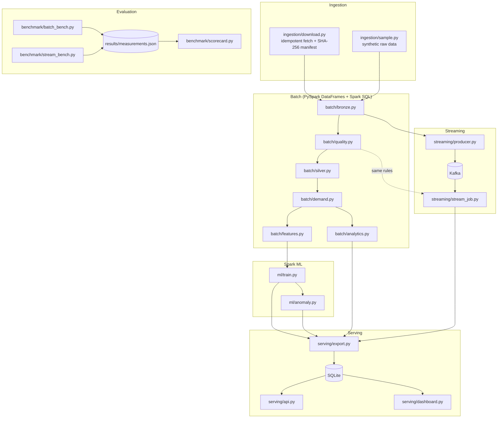

# 01 · Architecture

## 1. Components

| Module | Responsibility | Key Spark concepts |
|---|---|---|
| `common/config.py` | YAML + `MP__SECTION__KEY` env overrides + `{data_dir}` path templating | — |
| `common/spark.py` | One SparkSession factory (UTC session tz, AQE, dynamic partition overwrite, Kafka package) | configuration |
| `ingestion/download.py` | Download only missing/changed files, verify size + SHA-256, manifest | idempotency, lineage |
| `batch/bronze.py` | Canonical typed schema, `record_id`, lineage; NOAA field decoding | column pruning, schema enforcement |
| `batch/quality.py` | 10 ordered rules as pure column expressions (reused by streaming) | narrow transformations, window dedup |
| `batch/silver.py` | Valid → `silver/trips_clean`, rejects → `quarantine`, DQ report, hourly weather | broadcast join, persist, partitioned write |
| `batch/demand.py` | Dense zone × hour grid with pickups, drop-offs, trip stats, weather | groupBy shuffle, cross join, outer joins |
| `batch/features.py` | Lags, rolling means, calendar, label, time-based split | window functions (range partitioning) |
| `batch/analytics.py` | Six gold analytics tables in Spark SQL | Catalyst, CTEs, window ranking |
| `ml/train.py` | Baselines + LR / RF / GBT pipelines, segment metrics | Spark ML Pipelines, distributed training |
| `ml/anomaly.py` | Residual z-score, MAD rule labels, KMeans distance; injected evaluation | KMeans, percentile_approx |
| `streaming/producer.py` | Rate-controlled replay of bronze trips + malformed injection | Kafka keys/partitions |
| `streaming/stream_job.py` | Validate → DLQ; watermark, dedup, sliding windows, foreachBatch sinks | Structured Streaming, state, checkpoints |
| `serving/*` | Gold → SQLite, read-only parameterised queries, API, dashboard | — |
| `benchmark/*` | Repeated timed runs + Spark REST stage metrics, scorecard | shuffle/spill metrics |

## 2. Execution modes

| Mode | Spark | Kafka | Data |
|---|---|---|---|
| Tests | `local[2]`, UI off | none (file source stands in) | synthetic, temp dirs |
| Demo | `local[*]` | optional | synthetic in `~/mobilitypulse_sample` |
| Graded run | `local[*]`, 6 GB driver | Docker (Colima) single KRaft broker | real TLC/NOAA in `~/mobilitypulse_data` |

## 3. Key design decisions

1. **Wall-clock time model.** TLC timestamps are NYC local wall-clock without a zone. The Spark session time zone
   is pinned to UTC (and the Python process `TZ=UTC`) so wall-clock values pass through unchanged; NOAA UTC
   instants are converted once with `from_utc_timestamp(ts, 'America/New_York')`. Consequence: the DST fall-back
   hour merges two real hours and the spring-forward hour is an empty row — documented and visible in the grid.
2. **Bronze keeps every row.** Rejection happens in silver so that `input = valid + rejected` can be proven by
   re-reading what was written (target D1).
3. **Same rules in batch and streaming.** `quality.rules()` returns column expressions; the stream job reuses them,
   which is what makes exact stream-vs-batch reconciliation (S11) possible.
4. **Dense zone-hour grid.** Zero-demand hours are real observations, and row-based lags equal hour lags only when
   the series has no gaps.
5. **Idempotent writes.** `spark.sql.sources.partitionOverwriteMode=dynamic` replaces only the months being
   processed; re-running a month never duplicates data. Derived tables (features, analytics) use full overwrite.
6. **Small-file control.** `repartition("pickup_date")` before `partitionBy("pickup_date")` gives one file per day
   instead of one per shuffle partition per day.
7. **No Spark on the request path.** The API/dashboard read a small SQLite copy swapped atomically by `export`.
8. **Everything measurable.** Each stage writes its numbers to `results/measurements.json`; targets are evaluated
   from that file only.
