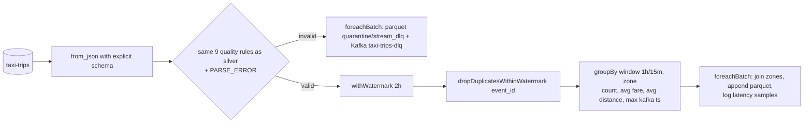

# 02 · Streaming design

## 1. Topology

| Item | Value (config key) |
|---|---|
| Broker | Apache Kafka 3.7.1, single KRaft node in Docker (`infra/docker-compose.yml`) |
| Main topic | `taxi-trips`, 4 partitions (`kafka.partitions`), key = `pickup_zone_id` |
| Dead-letter topic | `taxi-trips-dlq`, 1 partition, value = original payload + reason + offset |
| Producer | `streaming/producer.py`, `producer.events_per_second` (2,000) or `producer.speedup` × real time |
| Malformed injection | `producer.malformed_fraction` (1 %) — sent as *extra* messages with key `__malformed__:<kind>` |
| Spark source | `maxOffsetsPerTrigger` 50,000, `startingOffsets` earliest, `failOnDataLoss` false |
| Trigger | `processingTime` 5 s |
| Watermark | 2 h on `pickup_ts` (event time) |
| Windows | 1 h windows sliding every 15 min, per pickup zone |
| Output mode | `update` → `foreachBatch` append to `gold/stream_zone_metrics` |
| Checkpoints | `checkpoints/<run_tag>/{metrics,dlq}` |

Malformed kinds: `invalid_json`, `missing_pickup_ts`, `bad_zone` (999), `negative_distance`, `non_numeric` fare.

## 2. Query plan

Two queries share the source (each is an independent Kafka consumer with its own checkpoint), so the DLQ path
can never slow down or fail the metrics path.

## 3. Delivery semantics

| Layer | Guarantee | Why |
|---|---|---|
| Producer → Kafka | at-least-once (`acks=all`, retries) | broker acknowledges every write |
| Kafka → Spark | exactly-once processing of offsets | offsets + state stored in the checkpoint, replayed on restart |
| Spark → parquet sink | at-least-once rows, **idempotent view** | a batch re-executed after a crash appends rows with the same `batch_id`; readers take the newest row per `(zone_id, window_start)` by `batch_id`, so duplicates are harmless |
| Duplicate trips | removed | `dropDuplicatesWithinWatermark(event_id)` (`event_id` = bronze `record_id`) |
| Late events | dropped after watermark | replay is time-ordered; out-of-month timestamps are rejected to the DLQ before aggregation |

## 4. How latency is measured (targets S1–S3)

For every micro-batch, `write_metrics` writes the updated window rows, records `commit_ms` **after** the write
returns, then for every updated `(zone, window)` row computes

$$\text{latency} = \text{commit\_ms} - \text{max}(\text{Kafka append timestamp of events in that window})$$

i.e. the time from the newest contributing event being appended to Kafka until the metric reflecting it is
durably written. Samples go to `results/stream/latency_samples.csv`; per-batch summaries to `batches.csv`;
`StreamingQueryProgress` (input/processed rate, trigger duration, Kafka backlog = latestOffset − endOffset)
to `progress.csv`. `benchmark/stream_bench.py` drops the first `benchmark.stream_warmup_s` (60 s) and computes
p50/p95/p99 over the steady state.

This is the freshness of the **live (update-mode) metric** shown on the dashboard. Final, closed window values
additionally wait for the 2 h watermark by design.

## 5. Benchmarks (stream_bench.py)

| Command | What it does | Targets |
|---|---|---|
| `stream_bench main` | 4 partitions, 2,000 ev/s, 600 s, then DLQ accounting and stream-vs-batch reconciliation | S1–S4, S6, S10, S10b, S11 |
| `stream_bench rates` | 1k…20k ev/s × 120 s; sustained = processed ≥ 95 % of input and backlog not growing | S5 |
| `stream_bench partitions` | 1/2/4/8 partitions at 10k ev/s | S7 |
| `stream_bench recovery` | SIGKILL the job after 60 s, restart from the checkpoint, time to first committed batch, reconcile | S8, S9 |

Every trial runs the job as a subprocess with its own topic (`mp-bench-<tag>`), checkpoint and output dirs.
Reconciliation (S9, S11) needs `silver/zone_hour_demand` for the replayed month, so run the batch pipeline for
`producer.replay_month` first.
