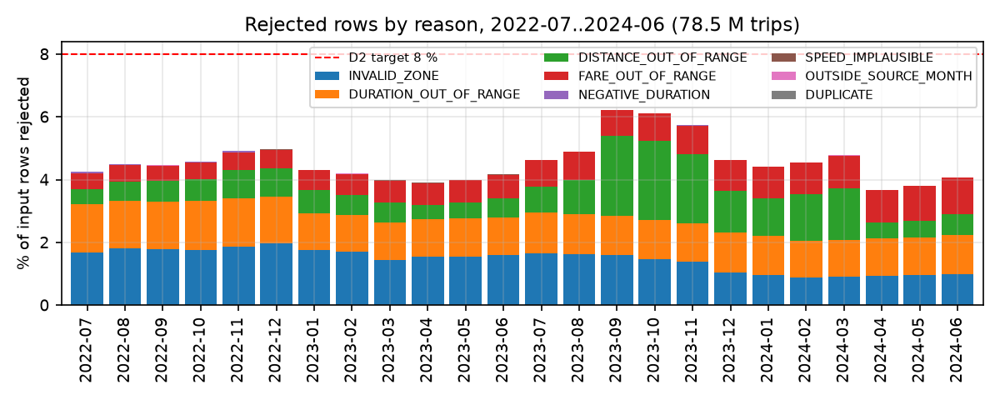
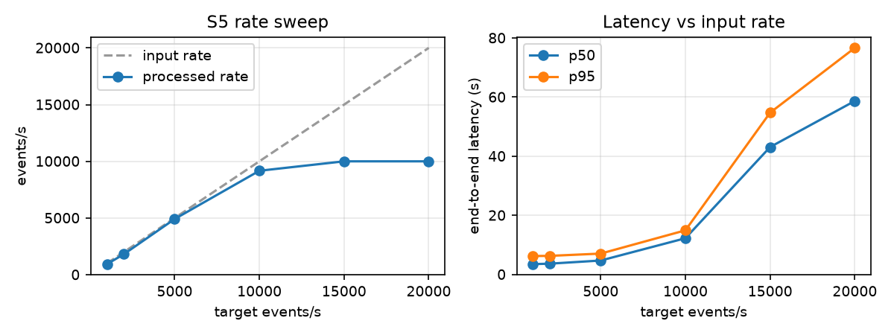
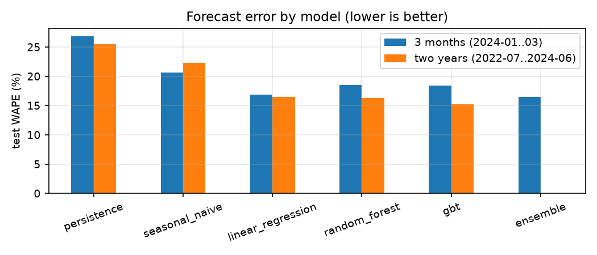
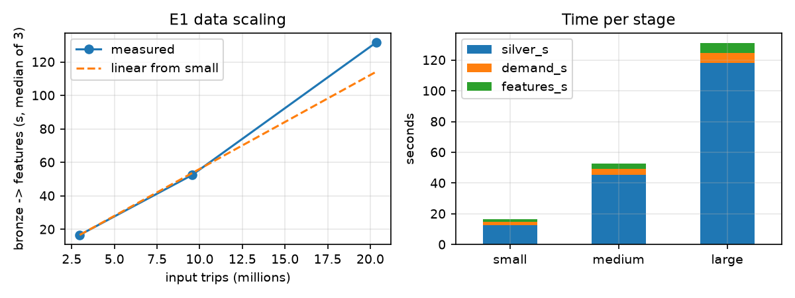
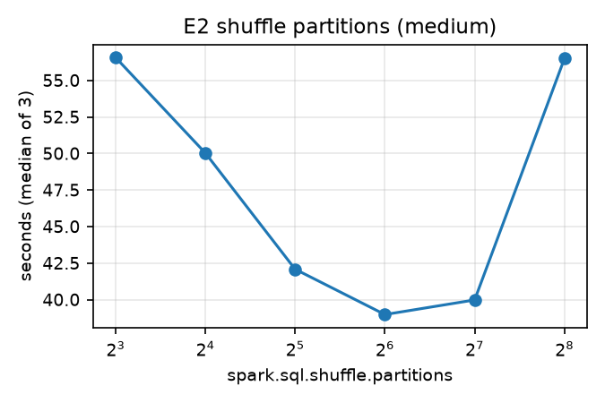
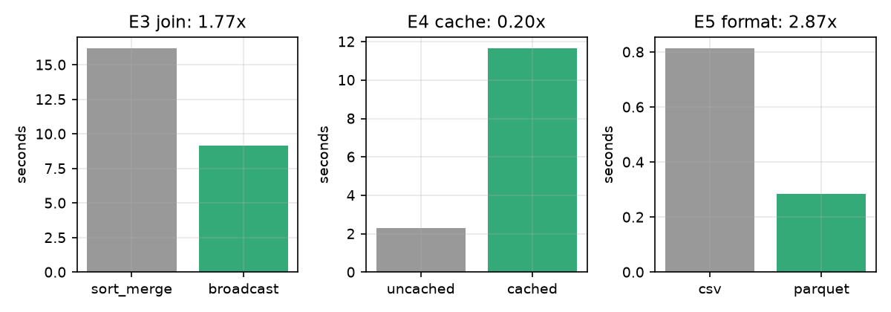
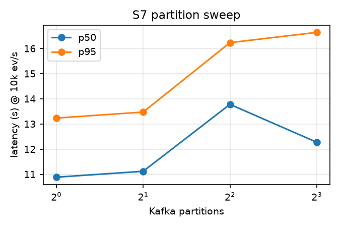

# 1. Summary

NYC MobilityPulse ingests public NYC yellow-taxi trips, enriches them with taxi-zone metadata and hourly NOAA
weather, and produces (a) zone-level demand analytics, (b) near-real-time demand metrics from a Kafka stream,
(c) next-hour demand forecasts per zone, and (d) anomaly alerts, served through a FastAPI service and a
Streamlit dashboard. Everything is built on Apache Spark 3.5 (DataFrames, Spark SQL, Structured Streaming,
Spark ML), Apache Kafka 3.7 and Parquet, as proposed.

All 45 evaluation targets were fixed in `configs/targets.yaml` **before** results were seen and are evaluated
automatically from `results/measurements.json` (`make scorecard`).

| Run | Data | PASS | FAIL | INFO | NOT RUN |
|---|---|---|---|---|---|
| Graded run (laptop) | 2024-01..03 for ML; 1/3/6 months for scaling | **30** | **14** | 1 | 0 |
| Two-year run (second machine) | 2022-07..2024-06, 78.5 M trips | 13 | 10 | – | 22 (not repeated) |

Every requirement of the proposal is implemented and demonstrable end to end. A fresh clone runs on
synthetic data in 3.1 minutes (D4). Every FAIL is explained in Section 9 with the measured value, root cause,
evidence and remediation.

# 2. Problem and goals

Taxi demand changes sharply across zones and hours with commuting peaks, weather and events. The goal is to
detect and anticipate these changes with a platform that scales with data volume and survives failures.

| Proposal goal | Delivered by |
|---|---|
| Reproducible ingestion and validation | `ingestion/download.py` (SHA-256 manifest, skip unchanged), 9 quality rules, quarantine, reconciliation |
| Layered Parquet storage | raw → bronze → silver → gold, partitioned by month or day |
| Spark SQL batch analytics | 6 gold tables (demand profile, top zones, weather impact, borough summary, volatility, OD flows) |
| Kafka replay + Structured Streaming | rate-controlled producer, watermark, dedup, sliding windows, dead-letter queue (DLQ), checkpoints |
| Spark ML forecasting | baselines + linear regression, random forest, GBT, validation-selected ensemble |
| Anomaly detection | residual z-score (main), MAD rule labels, KMeans distance |
| Dashboard / API | FastAPI (8 read-only endpoints) + Streamlit, reading a SQLite copy of gold |
| Scalable, fault tolerant, observable | partition/size experiments, checkpoint recovery test, per-stage metrics |

# 3. Data sources

| Source | Format | Grain | Volume used |
|---|---|---|---|
| NYC TLC Yellow Taxi trip records | monthly Parquet | one trip | 3 months = 9.55 M; 6 months = 20.3 M; 24 months = 78.5 M trips |
| NYC Taxi Zone Lookup | CSV | one zone (265) | broadcast dimension |
| NOAA ISD hourly, Central Park (72505394728) | CSV, encoded fields | one observation | ~35 k observations for 2022–2024 |

Known source problems handled by the pipeline: trips outside the file's month, negative durations, refunds
(negative fares), absurd distances, unknown zones 264/265, null passenger counts, duplicates, and schema drift
across years (`airport_fee` vs `Airport_fee`, int vs double).

# 4. Architecture and data layers

Rule of thumb: **raw = what we got, bronze = what it says, silver = what is true, gold = what it means.**
All data lives in `~/mobilitypulse_data` (outside the cloud-synced project folder).

| Layer | What happens | Storage |
|---|---|---|
| Raw | exact downloaded copies + manifest (size, SHA-256, status) | original Parquet/CSV, append-only |
| Bronze | canonical names/types, deterministic `record_id` hash, lineage columns, decoded weather; **no rows dropped** | Parquet, `trips` partitioned by `source_month`, `weather_obs` by `year` |
| Silver | quality rules, dedup, broadcast join with zones, hourly weather, dense zone × hour demand grid, ML features | Parquet: `trips_clean` by `pickup_date`, `zone_hour_demand` by `month`, `zone_hour_features` by `split` |
| Quarantine | rejected rows with reason; malformed stream events (DLQ) | Parquet by `source_month` |
| Gold | analytics tables, forecasts (by `model`), anomalies, model metrics, live stream window metrics (append) | Parquet; models as Spark `PipelineModel` |
| Serving | small copy of gold for the UI/API, swapped atomically | SQLite |

Pipeline (CLI stages): `ingest → bronze → silver → demand → features → analytics → ml → anomaly → export`.
Streaming path: `bronze trips → producer (replay) → Kafka (4 partitions) → Structured Streaming → gold + DLQ`.

**Key design decisions.**

1. **Idempotent writes.** Dynamic partition overwrite replaces only the months being processed.
2. **Bronze keeps every row.** This makes `input = valid + rejected` provable (D1).
3. **One rule set for batch and streaming.** The quality rules are pure column expressions shared by batch and streaming, which is what makes exact stream-vs-batch agreement possible (S11).
4. **Dense zone-hour grid.** Zero-demand hours are real observations, so row lags equal hour lags.
5. **No Spark on the request path.**

# 5. Batch pipeline and data quality

**Quality rules** (9 rules in fixed order; first failure is the reason): `NULL_TIMESTAMP`, `OUTSIDE_SOURCE_MONTH`,
`NEGATIVE_DURATION`, `DURATION_OUT_OF_RANGE`, `INVALID_ZONE`, `DISTANCE_OUT_OF_RANGE`, `FARE_OUT_OF_RANGE`,
`PASSENGERS_OUT_OF_RANGE`, `SPEED_IMPLAUSIBLE`, plus `DUPLICATE` for repeated `record_id`. After writing, silver
and quarantine are **re-read** and reconciled against bronze, so the check also verifies the writes.

| Metric | 3 months | 24 months |
|---|---|---|
| Input trips | 9.55 M | 78.48 M |
| Rejected | 4.4–4.8 % per month | 4.56 % overall, 3.7–6.2 % per month |
| Reconciliation diff (input − valid − rejected) | **0** | **0** in every month |
| Duplicates remaining in silver | 0 | 0 (checked for 2024-01..06) |
| Zone-hour demand vs silver trips | diff 0 | diff 0 |



Invalid zones (31.6 %), duration outliers (28.5 %), distance outliers (22.0 %) and fare outliers (17.5 %) account
for almost all rejects. The Sep–Nov 2023 peak (5.7–6.2 %) is driven by distance outliers in the source data.
The 2024-01..03 quality reports produced on the two machines are **byte-identical**, so the pipeline is
deterministic.

**Weather insight (gold `weather_impact`, Manhattan, 3 months).** Compared with dry hours, PM-peak pickups are
+17 % in light rain and +35 % in heavy rain, and off-peak pickups +7 % / +26 %, while average speed falls
(9.2 → 8.1 mph at PM peak). AM-peak pickups instead fall in heavy rain (−24 %). Heavy-rain samples are small
(7–21 hours per cell), so these are indicative only.

# 6. Streaming

| Setting | Value |
|---|---|
| Topic | `taxi-trips`, 4 partitions, key = pickup zone; DLQ topic `taxi-trips-dlq` |
| Trigger / max offsets | 5 s / 50,000 per trigger |
| Event-time handling | 2 h watermark on pickup time, `dropDuplicatesWithinWatermark(event_id)` |
| Aggregation | 1 h windows sliding every 15 min per zone, update mode → `foreachBatch` Parquet sink |
| Fault tolerance | checkpoints per run tag; idempotent reader view (latest row per zone/window by `batch_id`) |
| Malformed injection | 1 % extra messages: invalid JSON, missing timestamp, bad zone, negative distance, non-numeric fare |

**Why replay.** TLC publishes monthly files only, so there is no public live trip feed. The producer replays
bronze trips in pickup-time order at a fixed rate or a speed-up of real time, stamping each event with its send
time. Everything from Kafka onward is real streaming. Swapping in a live source would only change the producer.

**Latency definition.** Time from the newest contributing event being appended to Kafka until the window
metric containing it is durably written (sink commit time − max Kafka timestamp in the window). The first 60 s
of each trial are excluded as warm-up.

| Result (2,000 ev/s, 4 partitions, 10 min) | Value | Target |
|---|---|---|
| Latency p50 / p95 / p99 | 4.7 s / 10.5 s / 21.7 s | ≤ 5 / 10 / 15 s |
| Micro-batches within trigger interval | 95.3 % | ≥ 95 % |
| Kafka backlog p95 | 0 events | ≤ 10,000 |
| Malformed events routed to DLQ | 100 %, 0 unaccounted | 100 %, 0 |
| Stream vs batch agreement on closed hourly windows | 100 % | 100 % |
| Recovery after `kill -9` (to first committed batch) | 9.8 s, window counts 100 % identical | ≤ 30 s, 100 % |



The rate sweep shows the system keeps up to 5,000 ev/s with stable latency (p95 ≈ 7 s), processes about
9,200 ev/s at 10,000 ev/s with a growing backlog, and saturates at about 10,000 ev/s.

# 7. Forecasting and anomaly detection

**Task.** Predict pickups in zone *z* during hour *t+1* using only information available at the end of hour *t*.

**Features.**

- Lags 1/2/3/23/24/168 and rolling means.
- Same hour yesterday and last week.
- Zone hour-of-week profile, fitted on train only with leave-one-out.
- Calendar features and holidays.
- Observed weather.
- Borough.

**Split.** By time: the last 14 days are test, the 7 days before are validation, the rest is train. The model is
chosen on validation MAE and reported on test.

| Model (3 months, test = 2024-03-17..31) | MAE | RMSE | WAPE | R² | Train time |
|---|---|---|---|---|---|
| **Ensemble 0.7 LR + 0.3 GBT (selected)** | **4.76** | 12.11 | **16.5 %** | 0.966 | 137 s (all models) |
| Linear regression | 4.86 | 11.92 | 16.9 % | 0.967 | 3 s |
| GBT (150 trees, depth 8, log target) | 5.33 | 15.19 | 18.5 % | 0.946 | 134 s |
| Random forest (60 trees, depth 10) | 5.35 | 15.65 | 18.6 % | 0.943 | 32 s |
| Seasonal-naive baseline | 5.95 | 15.95 | 20.6 % | 0.941 | – |
| Persistence baseline | 7.75 | 20.06 | 26.9 % | 0.907 | – |

Feature engineering produced most of the gain. Adding seasonal and zone-profile features and training the tree
models on a log target lowered test MAE from 5.46 to 4.76 and WAPE from 18.9 % to 16.5 %.



**Anomaly detection.**

- The main detector scales each residual by √(forecast + 1), turns it into a per-zone z-score using validation
  statistics, and flags |z| ≥ max(3, 99.5th percentile of validation |z|).
- Quality is measured in two ways:
  1. **Injected anomalies:** 2 % of eligible test hours receive a ×3 spike or a ×0.2 drop (seed 7).
  2. **Agreement with MAD rule labels** on real data.

| Detector (3 months) | Precision | Recall | F1 | Alert rate |
|---|---|---|---|---|
| Residual z-score (main) | 0.66 | 0.90 | 0.76 | 0.78 % on real data |
| KMeans distance | 0.67 | 0.97 | 0.79 | – |
| MAD rule | 0.20 | 0.82 | 0.32 | – |

# 8. Evaluation

**Environment.**

| Item | Value |
|---|---|
| Graded runs | Apple M5 (10 cores: 4 performance + 6 efficiency), 16 GB RAM, macOS 26.7 |
| Spark | 3.5.3, `local[*]`, 6 GB driver (benchmarks: 10 GB) |
| Python / Java | 3.11 / 17 |
| Kafka | 3.7.1 KRaft, single broker in Colima (4 vCPU, 6 GB) |
| Two-year run | Windows host, Docker Desktop (20 vCPU, 15.3 GB), same Spark/Python/Java versions |

**Method.**

- Each batch experiment runs 3 times and reports the median.
- The cache is cleared between repetitions.
- Spark stage metrics (tasks, shuffle, spill, input bytes) are read from the Spark REST API per job group.
- Streaming trials use isolated topics, checkpoints and output folders per tag.

## 8.1 Batch scalability (E1–E5)



| Size | Trips | Runtime (median) | Throughput |
|---|---|---|---|
| Small (1 month) | 2.96 M | 16.6 s | 178 k rows/s |
| Medium (3 months) | 9.55 M | 52.5 s | 182 k rows/s |
| Large (6 months) | 20.33 M | 131.6 s | 155 k rows/s |

Scaling efficiency is $\eta = T_A \cdot k / T_B$, where $k$ is the growth in rows: 1.0 means perfectly linear,
and above 1.0 means fixed overheads are being spread over more data. Small → medium gives η = 1.02, because
fixed overhead is amortised. Medium → large gives η = **0.85** (B3 PASS). Silver dominates, rising from 76 % of
runtime (small) to 90 % (large).

Two observations explain the large-dataset slowdown:

- The cached `flagged` DataFrame no longer fits in a 6 GB driver. At medium size it already spills 315 MB; at
  large size it ran out of memory. The large run needed 10 GB.
- All work shares one machine's 10 cores, of which 6 are efficiency cores. That sets a serial ceiling (Amdahl's
  law).

The same effect appeared at two years: Random Forest ran out of memory at 6 GB and needed 10 GB on `local[8]`.

 

| Experiment | Result | Explanation |
|---|---|---|
| E2 shuffle partitions (8…256, AQE off) | best **64** (39 s); 8 → 57 s, 256 → 56 s | U-shape. Too few partitions leave cores idle and make large tasks; too many add scheduling overhead (1,425 tasks at 256). Shuffle volume is constant at ~2.8 GB. |
| E3 broadcast vs sort-merge join | **1.77×** faster | Broadcasting the 265-row zone table removes the shuffle of trips: 1.24 GB vs 3.58 GB shuffle write, 45 vs 87 tasks |
| E4 cache vs no cache | 0.20× (cache slower) | See Section 9 |
| E5 Parquet vs CSV (1 month) | 2.87× faster; CSV 6.5× larger | Parquet read 7 MB (column pruning) vs 326 MB for CSV; see Section 9 |

## 8.2 Streaming experiments



| Kafka partitions @ 10k ev/s | 1 | 2 | 4 | 8 |
|---|---|---|---|---|
| Latency p95 | 13.2 s | 13.5 s | 16.2 s | 16.6 s |
| Processed ev/s | 10,000 | 9,333 | 9,375 | 8,750 |

## 8.3 Two-year run (data-size scaling at 78.5 M trips)

The two-year run used the same pipeline on a second machine, with `MIN_ZONE_TRIPS=8000` (same trips/month bar),
tuning off and GBT depth 6, and **without the ensemble**. Its test window (2024-06-17..30) and zone set
(105 busiest zones) differ from the graded run, so absolute MAE is not directly comparable. WAPE is.

| Stage | Time (20 vCPU) | Stage | Time |
|---|---|---|---|
| Ingest (18 new months + NOAA) | 374 s | Features | 30 s |
| Bronze (78.5 M rows) | 177 s | Analytics | 56 s |
| Silver (4 × 6 months) | 521 s | ML (LR + RF + GBT) | 916 s |
| Demand (4.6 M zone-hours) | 37 s | Anomaly + export | 39 s |

| Target | 3 months | Two years | Reading |
|---|---|---|---|
| M1a MAE gain vs seasonal-naive | 19.9 % FAIL | **31.5 % PASS** | more history helps the learned models beat seasonal patterns |
| M4 WAPE | 16.5 % | **15.3 %** | better with more data |
| M7 GBT vs linear regression | −9.6 % | **+7.6 %** (GBT best) | trees need more data to beat a linear model |
| M8 worst-borough WAPE | 111.9 % | 81.9 % | improves, still above 35 % |
| O1 GBT training time | 2.2 min | 10.1 min | 7.5× more training rows, still ≤ 15 min |
| A2 / A3 anomaly precision / F1 | 0.66 / 0.76 | 0.43 / 0.58 | threshold not recalibrated for the larger, more varied data; KMeans reached 0.61 / 0.73 |
| D1 / D2 reconciliation / max reject rate | 0 / 4.8 % | 0 / 6.2 % | PASS on all 24 months |

# 9. Failure analysis

Targets were not changed after results were seen. Each FAIL below lists the measured value, the root cause with
evidence, what was tried, and the remaining gap.

| ID | Measured / target | Root cause and evidence | Tried / next step |
|---|---|---|---|
| **S2** latency p95 | 10.5 s / ≤ 10 s | Tail latency follows slow micro-batches: correlation 0.90 between per-batch p95 latency and trigger duration. Median trigger 2.7 s, p95 4.8 s, max 16.0 s. Worst batches carry 17–32 k rows (catch-up after a slow batch). With a 5 s trigger, an event waits up to 5 s before it is even read. | State-store shuffle partitions set to 8 (vs 32 in batch). Next: 2–3 s trigger, `maxOffsetsPerTrigger` ≈ 2× rate, RocksDB state store. Gap: 0.5 s. |
| **S3** latency p99 | 21.7 s / ≤ 15 s | Same mechanism, amplified: the slowest 1 % are the catch-up batches above (max latency 25.9 s), including occasional JVM GC and Parquet commit pauses in `foreachBatch` on a laptop shared with Kafka and the producer. | Same as S2. Separating the latency-sample `collect` from the commit path would also help. |
| **S5** max sustained rate | 5,000 / ≥ 10,000 ev/s | At 10k ev/s only 9,170 ev/s are processed and the backlog grows. Throughput plateaus at ~10k ev/s (figure in Section 6). One machine runs Spark (10 cores), Kafka (4 vCPU VM) and the single-threaded Python producer at once. | Two measurement bugs fixed before the final value (stale rows from an earlier run; idle drain counted as processing time). Next: run Kafka and the producer on a separate host. |
| **S7** 4 vs 1 partitions | −22.7 % / ≥ +30 % | More Kafka partitions add consumer tasks but no extra hardware. The bottleneck is the stateful aggregation and sink, not reading from Kafka. With a single broker and one machine, more partitions only add task overhead: p95 13.2 s (1 partition) → 16.2 s (4) → 16.6 s (8). | Valid negative result for a single-node setup. The target assumed multi-node parallelism. |
| **M1a** vs seasonal-naive | 19.9 % / ≥ 20 % | The seasonal-naive baseline is strong for a weekly-periodic series, and 2 months of training give few weekly cycles to learn from. | v1 → v2 features raised the gain from 8.1 % to 19.9 %. **PASS at two years (31.5 %).** |
| **M3** RMSE | 12.11 / ≤ 12 | RMSE is dominated by large errors in high-volume Manhattan zones (Manhattan MAE 9.9 vs 0.65 in the Bronx). | Ensemble cut RMSE from 13.0 to 12.1. Linear regression alone reaches 11.92 but has higher MAE; selection uses validation MAE as pre-registered. |
| **M7** GBT vs LR | −9.6 % / ≥ +10 % | Not enough data: on 3 months GBT is worse than LR. | GBT 150×8 on log target. On two years GBT beats LR by **+7.6 %** and becomes the best model, which confirms the data-size explanation. |
| **M8** worst-borough WAPE | 111.9 % / ≤ 35 % | Bronx yellow-taxi demand is about 0.6 trips per zone-hour (MAE 0.65 trips). Percentage errors explode when actuals are near zero. | Two years: 81.9 %. The target is unsuitable for near-empty boroughs; an absolute-error target would be appropriate. |
| **A2** precision (injected) | 0.66 / ≥ 0.70 | 121 false alerts vs 237 true alerts. Real anomalies in the test period also count as false positives, because ground truth covers injected hours only. | v1 → v2 (volume-scaled residual, calibrated threshold) raised precision from 0.48 to 0.66. KMeans reaches 0.67; combining both detectors is the next step. |
| **A4b** recall vs MAD rule | 0.10 / ≥ 0.60 | Different questions: MAD flags hours unusual versus **history** (1,182 hours); the residual detector flags hours unusual versus the **forecast** (168 alerts, 0.5 % alert budget). Hours the model anticipates (holidays, weather) are MAD-unusual but correctly not alerted. Precision vs MAD is 0.69 (A4a PASS). | Kept the alert budget (A5 PASS, 0.78 %), because operator load matters more. |
| **O2** inference throughput | 30,449 / ≥ 100,000 rows/s | Measured on only 52,909 test rows, so fixed Spark job overhead dominates. The ensemble runs two pipelines (LR 182,952 rows/s alone; GBT 36,528). | Next: measure on a larger scoring set, or use LR alone where its accuracy is sufficient. |
| **B2** bronze → silver throughput | 210 k / ≥ 250 k rows/s | Silver includes 9 rules, window dedup over `record_id` (shuffle), a broadcast join, and a `repartition(pickup_date)` before the partitioned write (a second shuffle; ~2.8 GB shuffle write at medium). Throughput: small 234 k, medium 210 k, large 172 k. | Next: drop the dedup window when `record_id` is unique per file, or replace `repartition` with `sortWithinPartitions`. |
| **B5** cache speedup | 0.20× / ≥ 1.5× | Caching materialises **all columns** (9.15 GB scanned into memory) for 5 aggregations that each need 1–2 columns. Without caching, Parquet column pruning reads only 0.27 GB. | Valid finding. Caching only pays off when cached data is narrow and reused many times. Next: `select` the needed columns before `cache()`. |
| **B7** Parquet vs CSV | 2.87× / ≥ 3× | Parquet reads 46× fewer bytes (7 MB vs 326 MB), but on one month the query takes only 0.28 s, so fixed job startup caps the measurable speedup. | Repeat on medium or large data, where I/O dominates. |

# 10. Deviations from the proposal

| Proposal | Delivered | Reason |
|---|---|---|
| Optional MongoDB for serving | SQLite | Sufficient for a read-only, small gold copy; no extra service to run |
| Large = multi-year on the laptop | Large = 6 months on the laptop; two years on a second machine | 16 GB laptop RAM (out-of-memory errors at 6 GB driver) |
| Live mobility events | Replay of historical trips | TLC data is published monthly; replay is the standard substitute |

# 11. Issues found and fixed during evaluation

1. `make bench-batch` / `make bench-stream` failed at start-up on Python 3.11. `argparse` rejects
   `nargs="*"` with `choices`, so the experiment names are now validated explicitly.
2. Streaming metric CSVs are append-only and batch ids restart after a reset, so re-running a trial tag mixed
   old and new rows. `--reset` now also clears that tag's rows.
3. `processed_eps` divided by a time span that included the idle drain after the producer stopped. It now uses
   only batches that received input.
4. Large-scale jobs need a 10 GB driver (`MP__SPARK__DRIVER_MEMORY=10g`).

# 12. Reproducibility

```bash
make setup                    # Python 3.11 venv + editable install
make demo                     # synthetic data end to end (3.1 min on a fresh clone)
make pipeline MONTHS=medium   # real data: ingest -> export
make kafka-up && make bench-stream
MP__SPARK__DRIVER_MEMORY=10g make bench-batch
make test && make scorecard   # 64 tests, 82 % coverage -> results/evaluation_scorecard.md
make api / make dashboard     # http://127.0.0.1:8000/docs, http://127.0.0.1:8501
```

Results: `results/` (graded) and `results_two_years/` (second machine), each with its own
`measurements.json` and `evaluation_scorecard.md`. Figures: `python report/make_figures.py`.

# 13. Conclusions and lessons learned

* **Design for proof, not hope.** Keeping every row in bronze and re-reading what was written gave an exact,
  repeatable `input = valid + rejected` across 78.5 M trips. Sharing one rule set between batch and streaming
  gave 100 % stream-vs-batch agreement.
* **Single-node limits are real.** Partition count (E2), broadcast joins (E3) and memory (out-of-memory errors
  at 6 GB) mattered more than raw core count. More Kafka partitions did not help without more hardware (S7).
* **Spark optimisations are workload-dependent.** Caching wide data was 5× slower than relying on Parquet column
  pruning (E4).
* **More data changes the model ranking.** Tree models lost to linear regression on 3 months and won on two
  years. The seasonal-naive gap target passed only with two years of history.
* **Measure carefully.** Two of the streaming results were initially wrong because of measurement bugs. Keeping
  the raw per-batch data allowed recomputation without re-running the experiments.

# Appendix A. Full scorecard (graded run)

See `results/evaluation_scorecard.md` (45 targets) and `results_two_years/evaluation_scorecard.md`.
Side-by-side table: `results_two_years/comparison_3m_vs_2y.csv`.
